# Apizr Academy

Learn it. Try it. Explain the result.

## From useful Python code to results you can explain

Follow the projects and decisions actually shown in Apizr Academy: inspect Requests, expose arithmetic and colour conversions, connect an OCI/MCP image to Ollama, then review fraud and Wine experiments.

Work through those questions in **12 lessons following the produced recordings**. Each has an integrated video, a written explanation, a concrete exercise and a correction you can open after trying it. Lessons I–V start with basic Python and introduce the Apizr/MCP workflow. Lessons VI–XI assume familiarity with notebooks and model evaluation; XII applies the review workflow in VS Code.

[Start with lesson 1](install.md){ .md-button .md-button--primary }
[Choose your learning path](#choose-your-learning-path){ .md-button }

<strong>12</strong> video lessons<strong>74 min</strong> of course videos<strong>3</strong> practical learning paths

!!! info "Choose the environment before you begin"
    **I–V were recorded with Apizr 0.4.3; VI–XII use the 0.4.6 development candidate**, which is not a published package release. Each lesson identifies its recorded version, chapters and exact transcript. Use [the current installation guide](../getting-started/install.md) for a new installation, or the identified recording environment to replay it. The written exercises follow the filmed case and pause questions.

## Choose your learning path

<article markdown="1">

### [01 · Build interfaces](#build-a-service)

For Python developers making a function callable by an application or an AI client. Begin with installation and inspection, make real REST and MCP calls, then follow an OCI image through an Ollama tool request.

**Lessons 1–5 · 29 min of video · hands-on work at your pace**

</article>

<article markdown="1">

### [02 · Understand experiments](#understand-experiments)

For developers and data scientists reading a notebook or selecting a prediction model. Distinguish source evidence, observed Runs, recorded differences and the precise context selected for serving.

**Lessons 6–9 · 27 min of video · requires the lesson 1 environment**

</article>

<article markdown="1">

### [03 · Track and review](#track-and-review)

For people who already work in Python, Jupyter or VS Code. Choose meaningful capture boundaries, read actual execution history and review measured results in the editor.

**Lessons 10–12 · 19 min of video · basic Run concepts from lessons 6–8 help**

</article>

## Build interfaces

Each video names its own source: four utility projects for installation, Requests for analysis, keon/algorithms for REST, TheAlgorithms/Python for MCP, and the Apizr shop for OCI with Ollama. The changes of repository are part of the recorded progression.

<article class="apizr-academy-course" markdown="1">
<a class="apizr-academy-course__cover" href="install/">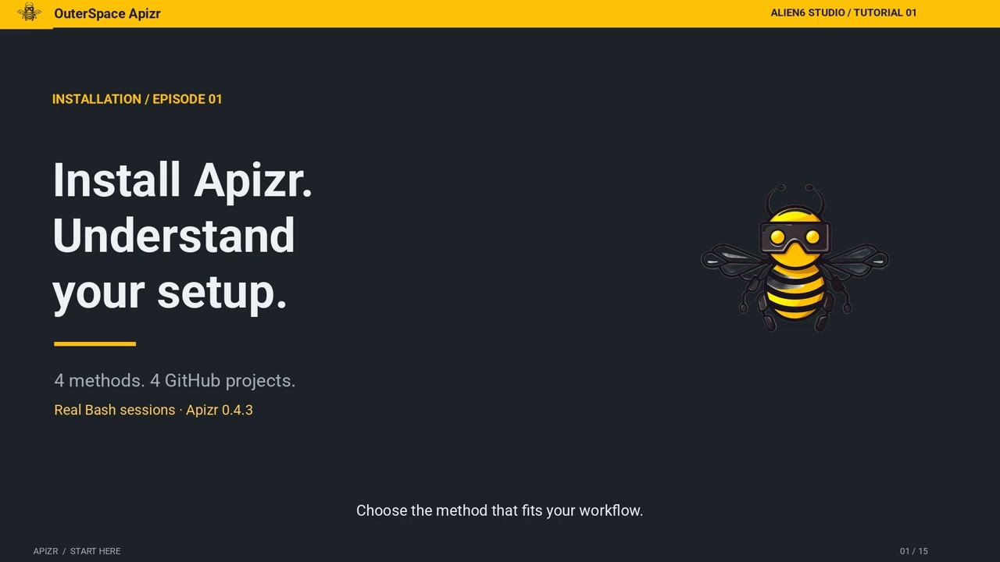</a>

### 01 · [Install Apizr. Understand your setup.](install.md)

Choose one installation method, identify its environment and read an actual inspection result.

Video 6:39 · Plan about 20 min

[Open the lesson](install.md)

</article>
<article class="apizr-academy-course" markdown="1">
<a class="apizr-academy-course__cover" href="inspect/">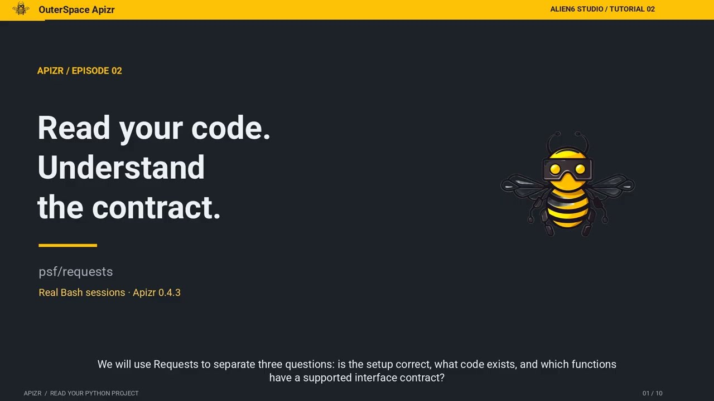</a>

### 02 · [Read your code. Understand the contract.](inspect.md)

Separate setup checks, repository inventory and the unsupported Requests.get contract.

Video 4:11 · Plan about 20 min

[Open the lesson](inspect.md)

</article>
<article class="apizr-academy-course" markdown="1">
<a class="apizr-academy-course__cover" href="rest/">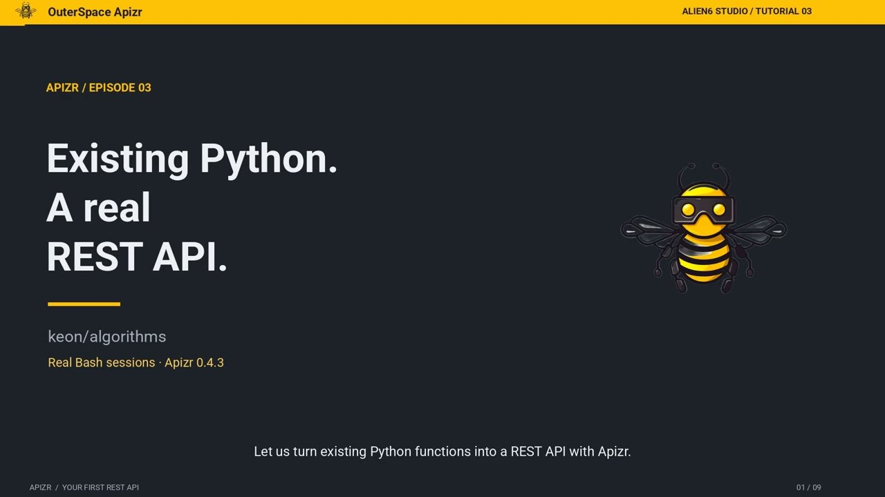</a>

### 03 · [Existing Python. A real REST API.](rest.md)

Expose two functions from keon/algorithms and verify successful calls and HTTP 422.

Video 4:14 · Plan about 25 min

[Open the lesson](rest.md)

</article>
<article class="apizr-academy-course" markdown="1">
<a class="apizr-academy-course__cover" href="mcp/">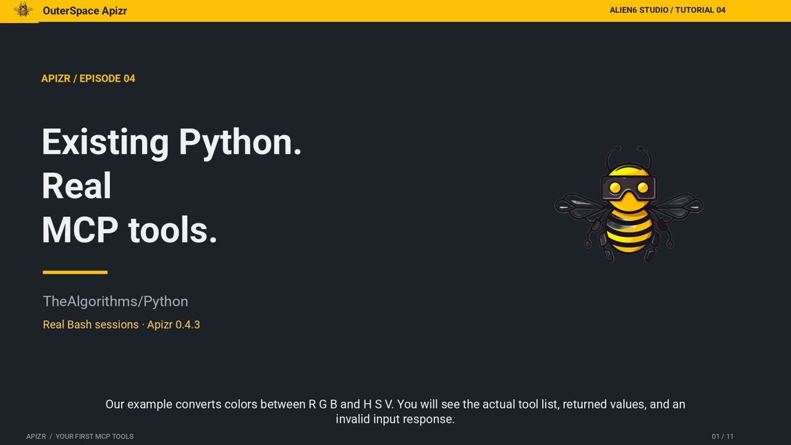</a>

### 04 · [Existing Python. Real MCP tools.](mcp.md)

Discover two generated colour-conversion tools, make real calls and read an error.

Video 5:09 · Plan about 25 min

[Open the lesson](mcp.md)

</article>
<article class="apizr-academy-course" markdown="1">
<a class="apizr-academy-course__cover" href="oci/">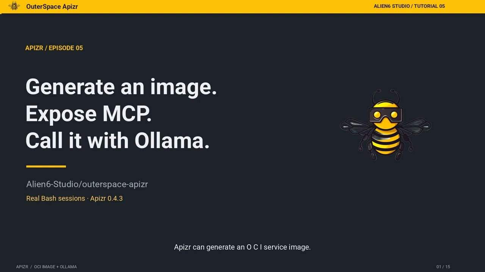</a>

### 05 · [Generate an image. Expose MCP. Call it with Ollama.](oci.md)

Follow the recorded OCI plugin build and the actual local model-to-container tool call.

Video 8:21 · Plan about 30 min

[Open the lesson](oci.md)

</article>

## Understand experiments

Follow the synthetic fraud case through inspection, retained Runs, comparison and a selected prediction. Replay the same notebook, data changes, integrity refusals and comparison variants as the recordings.

<article class="apizr-academy-course" markdown="1">
<a class="apizr-academy-course__cover" href="experiment-inspection/">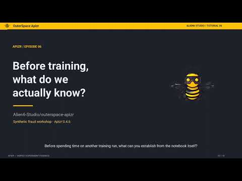</a>

### 06 · [Before training, what do we actually know?](experiment-inspection.md)

Read static evidence, change the CSV and distinguish notebook bytes from scientific signals.

Video 5:54 · Plan about 20 min

[Open the lesson](experiment-inspection.md)

</article>
<article class="apizr-academy-course" markdown="1">
<a class="apizr-academy-course__cover" href="runs/">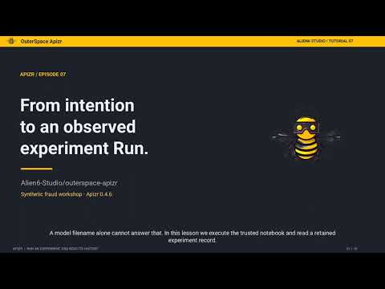</a>

### 07 · [From intention to an observed experiment Run.](runs.md)

Connect Plan, actual metrics and model identity, then test a corrupted store.

Video 6:15 · Plan about 25 min

[Open the lesson](runs.md)

</article>
<article class="apizr-academy-course" markdown="1">
<a class="apizr-academy-course__cover" href="comparison/">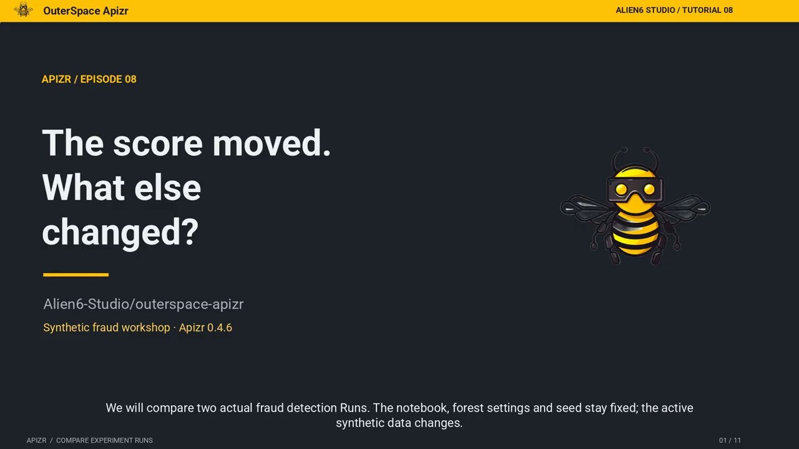</a>

### 08 · [The score moved. What else changed?](comparison.md)

Read material changes, the actual metric trade-off, self-comparison and reverse deltas.

Video 7:15 · Plan about 25 min

[Open the lesson](comparison.md)

</article>
<article class="apizr-academy-course" markdown="1">
<a class="apizr-academy-course__cover" href="model-serving/">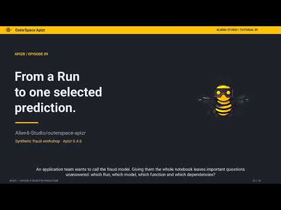</a>

### 09 · [From a Run to one selected prediction.](model-serving.md)

Select the Run, fraud_detection.predict, model bytes and scientific dependencies.

Video 6:49 · Plan about 30 min

[Open the lesson](model-serving.md)

</article>

## Track and review

Move from explicit Python capture to a live Jupyter kernel, then review real Wine classification Runs in VS Code. Keep the observation separate from the scientific conclusion.

<article class="apizr-academy-course" markdown="1">
<a class="apizr-academy-course__cover" href="python-tracking/">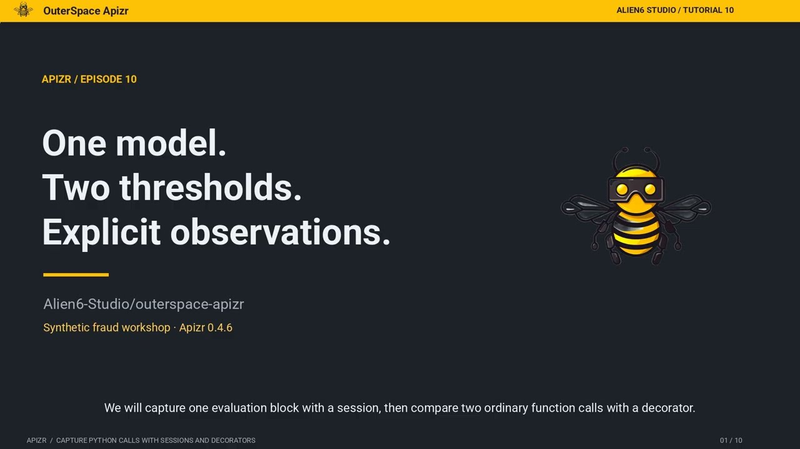</a>

### 10 · [One model. Two thresholds. Explicit observations.](python-tracking.md)

Track actual threshold evaluations, preserve returns and inspect the failed capture.

Video 6:29 · Plan about 25 min

[Open the lesson](python-tracking.md)

</article>
<article class="apizr-academy-course" markdown="1">
<a class="apizr-academy-course__cover" href="jupyter/">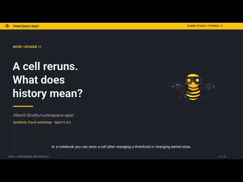</a>

### 11 · [A cell reruns. What does history mean?](jupyter.md)

Read four real captures, repeat first-variant and explain the unlogged offset.

Video 5:55 · Plan about 25 min

[Open the lesson](jupyter.md)

</article>
<article class="apizr-academy-course" markdown="1">
<a class="apizr-academy-course__cover" href="vscode/">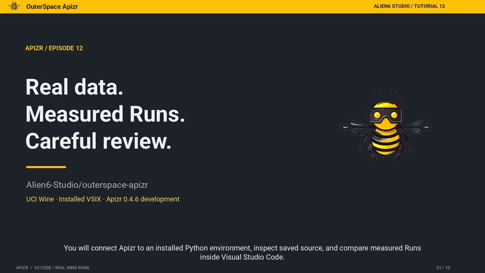</a>

### 12 · [Real data. Measured Runs. Careful review.](vscode.md)

Read recorded source, compare measured Wine Runs and recognize stale evidence.

Video 6:22 · Plan about 30 min

[Open the lesson](vscode.md)

</article>

## See the whole journey

Before the course, watch this 2:34 demonstration of a route calculation used through REST and MCP. It shows the end result; the lessons above explain the decisions and let you practise them.

  <a class="apizr-demo-video__cover" href="https://www.youtube.com/watch?v=u8e0fi2m80M" data-apizr-video="u8e0fi2m80M" data-apizr-title="Turn existing Python expertise into APIs and AI tools" aria-label="Play: Turn existing Python expertise into APIs and AI tools">
    
    ▶ Watch the demo
  </a>

[Open the Academy playlist on YouTube](https://www.youtube.com/playlist?list=PLPxU4WUOuPeQ).

## Keep the concepts close

Use these short references whenever a lesson raises a question: [Capability](capabilities.md), [Readiness](readiness.md), [Exposure](exposure.md), [Execution](execution.md) and [Interfaces](interfaces.md). The [written walkthrough](../getting-started/quickstart.md) and [notebook-to-service guide](../getting-started/data-science.md) provide the complete commands.

Videos play inside the lesson after you select Play. Their covers are local; YouTube loads only at that point through its privacy-enhanced player. You can complete the written exercises without loading a video.

