# Apizr Academy

Start with an existing Python function and follow it through inspection, selection
and your first REST or MCP call. Then follow a synthetic fraud example through
experiment inspection, retained Runs, comparison, serving and Python tracking.
These English-language lessons explain the results, their limits and the next
decision. The written guides remain authoritative: a recording may show an
earlier version of Apizr.

The covers below are local images. YouTube loads only when you select a play
button; playback uses its privacy-enhanced player. Each lesson also links to
written steps you can follow without watching a video.

[Open the Academy playlist on YouTube](https://www.youtube.com/playlist?list=PLPxU4WUOuPeQ).

## Start here: from Python to a callable service

### 00 — See the result

**Turn existing Python expertise into APIs and AI tools** · Demonstration
· 2:34

Result: see an existing route calculation used by an application and an AI
assistant through REST and MCP.

  <a class="apizr-demo-video__cover" href="https://www.youtube.com/watch?v=u8e0fi2m80M" data-apizr-video="u8e0fi2m80M" data-apizr-title="Turn existing Python expertise into APIs and AI tools" aria-label="Play: Turn existing Python expertise into APIs and AI tools">
    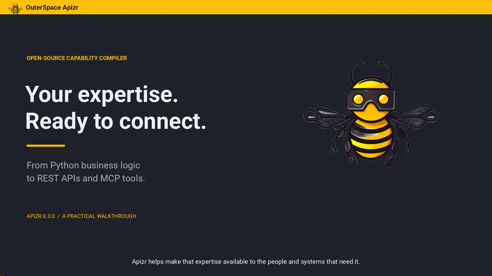
    ▶ Watch the demo
  </a>

[Follow the written steps](../getting-started/quickstart.md) ·
[Understand capabilities](capabilities.md)

### 01 — Install

**Academy Part I — Install Apizr with pip, uv, pipx or Homebrew** · 6:39

Result: install Apizr in your chosen environment and check its version.

  <a class="apizr-demo-video__cover" href="https://www.youtube.com/watch?v=7J6TWqAdx4Q" data-apizr-video="7J6TWqAdx4Q" data-apizr-title="Install Apizr with pip, uv, pipx or Homebrew" aria-label="Play: Install Apizr with pip, uv, pipx or Homebrew">
    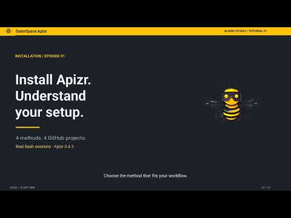
    ▶ Watch the tutorial
  </a>

[Follow the written steps](../getting-started/install.md)

### 02 — Inspect

**Academy Part II — Inspect a project and understand readiness** · 4:11

Result: identify a function's interface contract and read the reasons it is ready,
conditional or refused, without running project code.

  <a class="apizr-demo-video__cover" href="https://www.youtube.com/watch?v=Ypgp8fCof0E" data-apizr-video="Ypgp8fCof0E" data-apizr-title="Inspect a project and understand readiness" aria-label="Play: Inspect a project and understand readiness">
    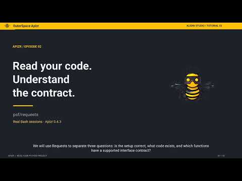
    ▶ Watch the tutorial
  </a>

[Follow the written steps](../getting-started/user-guide/inspect.md) ·
[Understand Readiness](readiness.md)

### 03 — REST

**Academy Part III — Generate a REST API and make HTTP calls** · 4:14

Result: generate a REST bundle and call a selected Python function over HTTP.

  <a class="apizr-demo-video__cover" href="https://www.youtube.com/watch?v=QdtaLoc-g6o" data-apizr-video="QdtaLoc-g6o" data-apizr-title="Generate a REST API and make HTTP calls" aria-label="Play: Generate a REST API and make HTTP calls">
    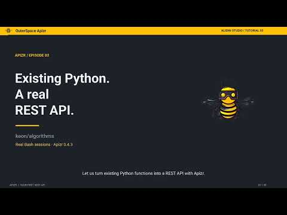
    ▶ Watch the tutorial
  </a>

[Follow the written steps](../getting-started/user-guide/rest.md) ·
[Choose what becomes public](exposure.md)

### 04 — MCP

**Academy Part IV — Generate MCP tools and call them with Python** · 5:09

Result: generate an MCP bundle, discover its tools and call one with a Python
client.

  <a class="apizr-demo-video__cover" href="https://www.youtube.com/watch?v=rJThRd9vq4g" data-apizr-video="rJThRd9vq4g" data-apizr-title="Generate MCP tools and call them with Python" aria-label="Play: Generate MCP tools and call them with Python">
    
    ▶ Watch the tutorial
  </a>

[Follow the written steps](../getting-started/user-guide/mcp.md) ·
[Understand REST and MCP](interfaces.md)

### 05 — OCI

**Academy Part V — Build an OCI image and call its MCP tool with Ollama** · 8:21

Result: build a service image from an existing bundle and call its MCP tool from
the demonstrated Ollama client.

  <a class="apizr-demo-video__cover" href="https://www.youtube.com/watch?v=_PwRZeBN1fM" data-apizr-video="_PwRZeBN1fM" data-apizr-title="Build an OCI image and call its MCP tool with Ollama" aria-label="Play: Build an OCI image and call its MCP tool with Ollama">
    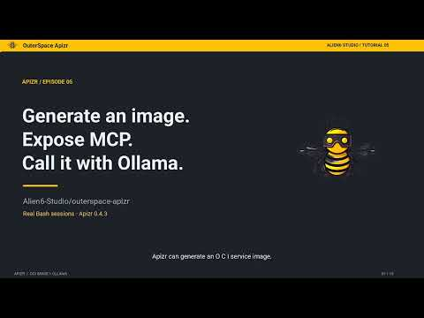
    ▶ Watch the tutorial
  </a>

[Follow the written steps](../reference/oci-service-plugin.md) ·
[Choose the execution boundary](execution.md)

## Understand the decisions

Read these short chapters in order, or open the one that answers your next
question:

1. [What is a capability?](capabilities.md)
2. [What does Readiness decide?](readiness.md)
3. [What does Exposure select?](exposure.md)
4. [Where does execution happen?](execution.md)
5. [What do REST and MCP expose?](interfaces.md)

## Experiment path — from evidence to serving

These advanced lessons use the same synthetic fraud example and a recorded
Apizr 0.4.6 candidate. Start with the
[Data Scientist quickstart](../getting-started/data-science.md), then use each
lesson's written guide to repeat the operations and check their current scope.

### 06 — Inspect experiment evidence

**Academy Part VI — Inspect a machine learning notebook without running it** · 5:54

Result: read inspection evidence, change the selected CSV and distinguish a
recognized metric call from an observed result, before training the model.

  <a class="apizr-demo-video__cover" href="https://www.youtube.com/watch?v=9P5F42RYCRs" data-apizr-video="9P5F42RYCRs" data-apizr-title="Inspect a machine learning notebook without running it" aria-label="Play: Inspect a machine learning notebook without running it">
    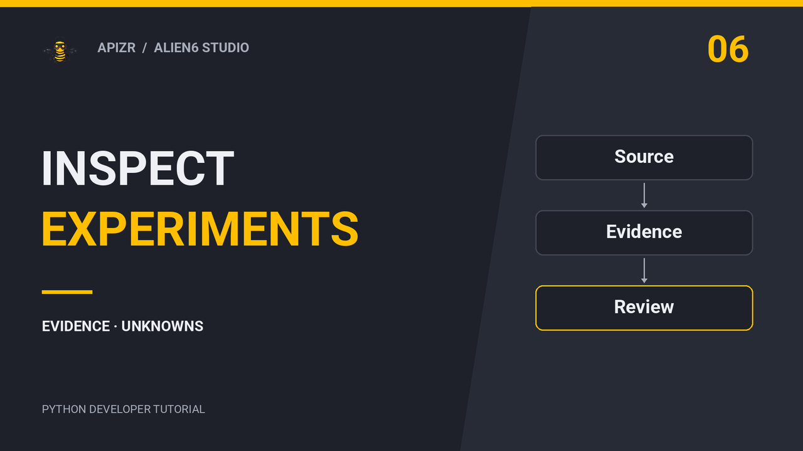
    ▶ Watch the tutorial
  </a>

[Follow the written steps](../getting-started/user-guide/experiment-inspection.md)

### 07 — Run an experiment and read its history

**Academy Part VII — From notebook to Run: experiments and local history** · 6:15

Result: execute the reviewed notebook, read its retained evidence and distinguish
an artifact fingerprint from preservation of the artifact's bytes.

  <a class="apizr-demo-video__cover" href="https://www.youtube.com/watch?v=XHszreGQhMY" data-apizr-video="XHszreGQhMY" data-apizr-title="Run an experiment and read its history" aria-label="Play: Run an experiment and read its history">
    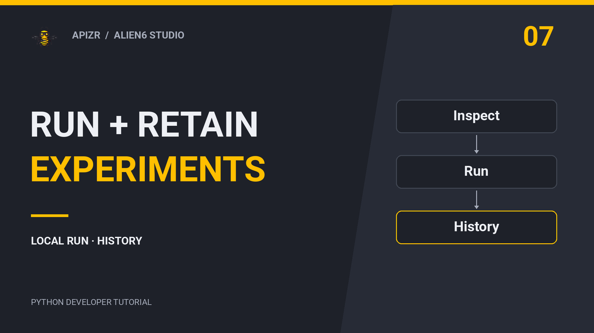
    ▶ Watch the tutorial
  </a>

[Follow the written steps](../getting-started/user-guide/experiment-runs.md)

### 08 — Compare experiment Runs

**Academy Part VIII — Compare data, models and observed metrics** · 7:15

Result: compare two actual Runs, interpret metric deltas in both directions and
keep unknown evidence explicit. Changed synthetic label rules limit the
conclusions that can be drawn about model quality.

  <a class="apizr-demo-video__cover" href="https://www.youtube.com/watch?v=uu01blkTRRg" data-apizr-video="uu01blkTRRg" data-apizr-title="Compare experiment Runs: data, models and metrics" aria-label="Play: Compare experiment Runs: data, models and metrics">
    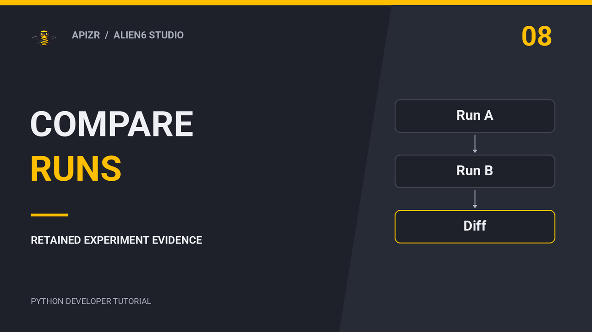
    ▶ Watch the tutorial
  </a>

[Follow the written steps](../getting-started/user-guide/experiment-comparison.md)

### 09 — Expose a selected prediction

**Academy Part IX — Bind a retained model to REST and MCP** · 6:50

Result: select a Run, prediction capability, retained model and dependencies;
inspect both local interface bundles and observe the refusal of changed model
bytes. Deployment remains a separate step.

  <a class="apizr-demo-video__cover" href="https://www.youtube.com/watch?v=s68H9yhNWgk" data-apizr-video="s68H9yhNWgk" data-apizr-title="Bind a retained model to REST and MCP" aria-label="Play: Bind a retained model to REST and MCP">
    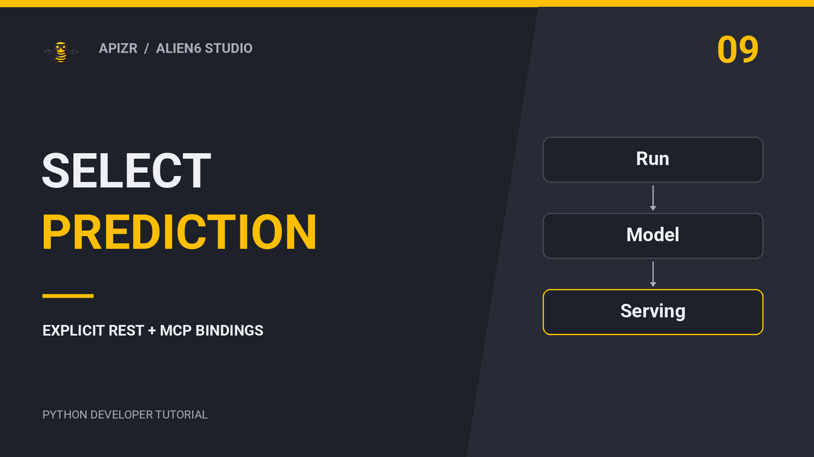
    ▶ Watch the tutorial
  </a>

[Follow the written steps](../getting-started/user-guide/experiment-exposure.md)

### 10 — Track Python calls

**Academy Part X — Capture calls with sessions and decorators** · 6:30

Result: evaluate classification thresholds on the same held-out sample, choose
the unit of capture and retain selected inputs and observed metrics while
preserving normal return values and exceptions.

  <a class="apizr-demo-video__cover" href="https://www.youtube.com/watch?v=Cge2-6L5cSE" data-apizr-video="Cge2-6L5cSE" data-apizr-title="Track Python calls with sessions and decorators" aria-label="Play: Track Python calls with sessions and decorators">
    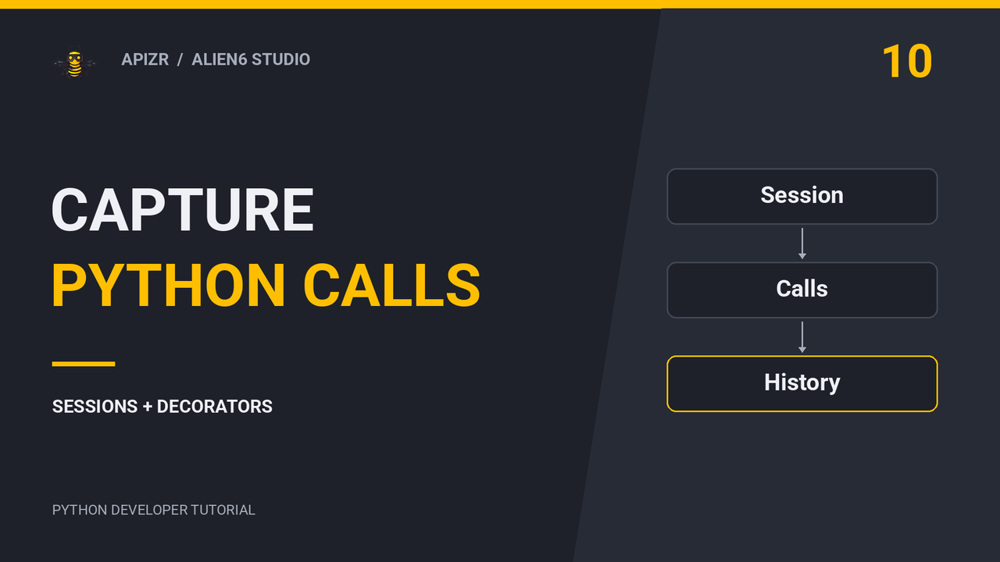
    ▶ Watch the tutorial
  </a>

[Follow the written steps](../getting-started/tracking.md)

### 11 — Capture real Jupyter cells

**Academy Part XI — Track cell executions and hidden kernel state** · 5:56

Result: read actual cell identities and execution counts from a live Jupyter
kernel, repeat a cell and compare its retained evidence. The recording shows the
real kernel through a terminal; selected file and parameter identities do not
identify every in-memory value or setting.

  <a class="apizr-demo-video__cover" href="https://www.youtube.com/watch?v=VqTmKCU-Auo" data-apizr-video="VqTmKCU-Auo" data-apizr-title="Track real Jupyter cell executions and hidden kernel state" aria-label="Play: Track real Jupyter cell executions and hidden kernel state">
    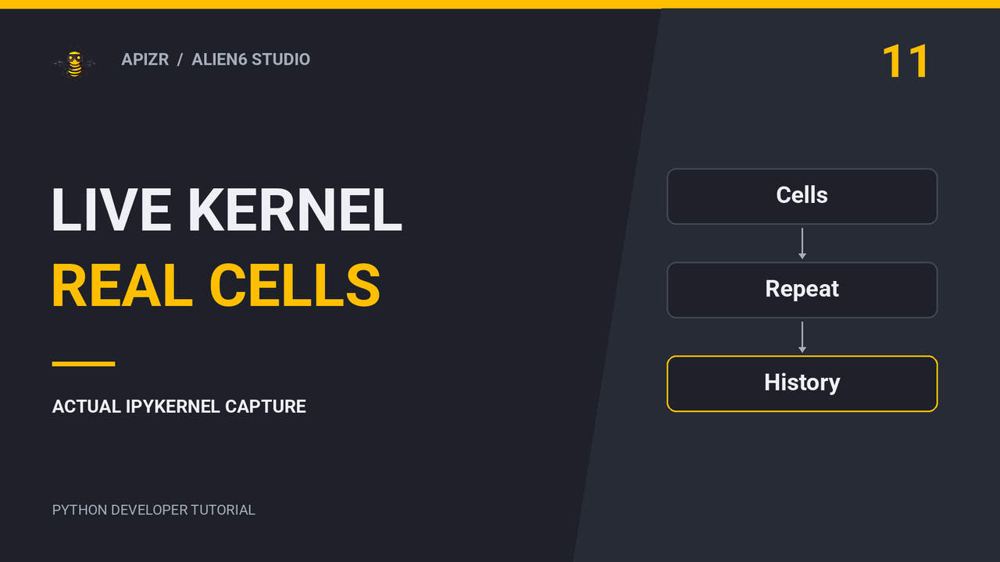
    ▶ Watch the tutorial
  </a>

[Follow the written steps](../getting-started/tracking.md#3-use-the-same-calls-in-jupyter)

## Next recordings

| Planned lesson | Recording | Written steps |
| --- | --- | --- |
| Part XII — Inspect and compare Runs in VS Code | In preparation | [VS Code guide](../reference/vscode.md) |

A planned lesson does not establish that its feature has been qualified. The
linked guides state their current scope and limits.
