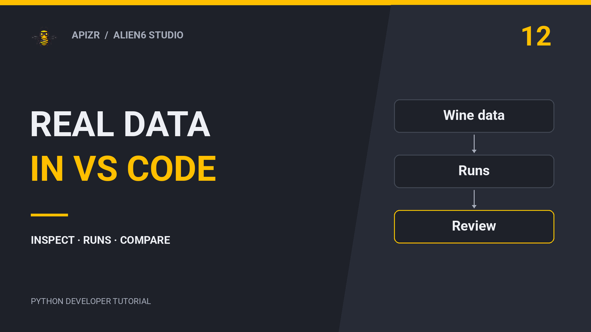

# Apizr Academy

Learn it. Try it. Explain the result.

## From useful Python code to results you can explain

A teammate gives you a Python function and a training notebook. What can you safely describe? Which function should become callable? What did an experiment actually record, and what remains unknown?

Work through those questions in **12 complete lessons**. Each has an integrated video, a written explanation, a concrete exercise and a correction you can open after trying it. You need basic Python; no prior Apizr or MCP knowledge is assumed.

[Start with lesson 1](install.md){ .md-button .md-button--primary }
[Choose your learning path](#choose-your-learning-path){ .md-button }

<strong>12</strong> video lessons<strong>74 min</strong> of course videos<strong>3</strong> practical learning paths

!!! info "Choose the environment before you begin"
    The exercises target **Apizr 0.4.6 development**, which is not a published package release. [Lesson 1](install.md) explains how to choose the documented development installation or the stable 0.4.5 alternative. Earlier videos retain their originally demonstrated version. The practice-time estimates include watching and trying the exercise; take longer whenever you need it.

## Choose your learning path

<article markdown="1">

### [01 · Build a service](#build-a-service)

For Python developers making a function callable by an application or an AI client. Begin with installation and inspection, make real REST and MCP calls, then understand the container handoff.

**Lessons 1–5 · 29 min of video · hands-on work at your pace**

</article>

<article markdown="1">

### [02 · Understand experiments](#understand-experiments)

For developers and data scientists reading a notebook or selecting a prediction model. Distinguish source evidence, observed Runs, recorded differences and the precise context selected for serving.

**Lessons 6–9 · 27 min of video · requires the lesson 1 environment**

</article>

<article markdown="1">

### [03 · Track and review](#track-and-review)

For people who already work in Python, Jupyter or VS Code. Choose meaningful capture boundaries, read actual execution history and review measured results in the editor.

**Lessons 10–12 · 19 min of video · basic Run concepts from lessons 6–8 help**

</article>

## Build a service

Start with the shop’s price and stock calculations. Your result is a real local call, plus an explanation of what generation, execution and publication each establish.

<article class="apizr-academy-course" markdown="1">

### 01 · [Install Apizr in the right environment](install.md)

Choose an installation you can explain and verify.

Video 6:39 · Plan about 20 min

[Open the lesson](install.md)

</article>
<article class="apizr-academy-course" markdown="1">

### 02 · [Read a Python contract before running code](inspect.md)

Separate a callable description, readiness and permission.

Video 4:11 · Plan about 20 min

[Open the lesson](inspect.md)

</article>
<article class="apizr-academy-course" markdown="1">

### 03 · [Turn a selected function into a REST call](rest.md)

Connect Python arguments, an HTTP request and an observed response.

Video 4:14 · Plan about 25 min

[Open the lesson](rest.md)

</article>
<article class="apizr-academy-course" markdown="1">

### 04 · [Expose the same calculation as an MCP tool](mcp.md)

Discover and call a tool before introducing an AI client.

Video 5:09 · Plan about 25 min

[Open the lesson](mcp.md)

</article>
<article class="apizr-academy-course" markdown="1">

### 05 · [Package a service for another machine](oci.md)

Distinguish a generated bundle, a built image and a published image.

Video 8:21 · Plan about 30 min

[Open the lesson](oci.md)

</article>

## Understand experiments

Follow the synthetic fraud case through inspection, retained Runs, comparison and a selected prediction. Each lesson also offers a smaller exercise to make the evidence easier to reason about.

<article class="apizr-academy-course" markdown="1">

### 06 · [Inspect a notebook without inventing results](experiment-inspection.md)

Tell source evidence from values observed during execution.

Video 5:54 · Plan about 20 min

[Open the lesson](experiment-inspection.md)

</article>
<article class="apizr-academy-course" markdown="1">

### 07 · [Run trusted code and read its retained evidence](runs.md)

Connect the intended Plan, the observed Run and the files you retain.

Video 6:15 · Plan about 25 min

[Open the lesson](runs.md)

</article>
<article class="apizr-academy-course" markdown="1">

### 08 · [Compare Runs and interpret a metric delta](comparison.md)

Describe observed differences without claiming they caused an improvement.

Video 7:15 · Plan about 25 min

[Open the lesson](comparison.md)

</article>
<article class="apizr-academy-course" markdown="1">

### 09 · [Bind a reviewed model to a callable prediction](model-serving.md)

Choose exact evidence, model bytes and an interface.

Video 6:50 · Plan about 30 min

[Open the lesson](model-serving.md)

</article>

## Track and review

Move from explicit Python capture to a live Jupyter kernel, then review real Wine classification Runs in VS Code. Keep the observation separate from the scientific conclusion.

<article class="apizr-academy-course" markdown="1">

### 10 · [Choose the unit you capture in Python](python-tracking.md)

Record useful observations while preserving ordinary function behaviour.

Video 6:30 · Plan about 25 min

[Open the lesson](python-tracking.md)

</article>
<article class="apizr-academy-course" markdown="1">

### 11 · [Read a notebook’s actual execution history](jupyter.md)

Distinguish saved cells, live state and recorded cell executions.

Video 5:56 · Plan about 25 min

[Open the lesson](jupyter.md)

</article>
<article class="apizr-academy-course" markdown="1">

### 12 · [Review real experiment Runs in VS Code](vscode.md)

Read recorded source, compare measured Wine Runs and recognize stale evidence.

Video 6:22 · Plan about 30 min

[Open the lesson](vscode.md)

</article>

## See the whole journey

Before the course, watch this 2:34 demonstration of a route calculation used through REST and MCP. It shows the end result; the lessons above explain the decisions and let you practise them.

  <a class="apizr-demo-video__cover" href="https://www.youtube.com/watch?v=u8e0fi2m80M" data-apizr-video="u8e0fi2m80M" data-apizr-title="Turn existing Python expertise into APIs and AI tools" aria-label="Play: Turn existing Python expertise into APIs and AI tools">
    
    ▶ Watch the demo
  </a>

[Open the Academy playlist on YouTube](https://www.youtube.com/playlist?list=PLPxU4WUOuPeQ).

## Keep the concepts close

Use these short references whenever a lesson raises a question: [Capability](capabilities.md), [Readiness](readiness.md), [Exposure](exposure.md), [Execution](execution.md) and [Interfaces](interfaces.md). The [written walkthrough](../getting-started/quickstart.md) and [notebook-to-service guide](../getting-started/data-science.md) provide the complete commands.

Videos play inside the lesson after you select Play. Their covers are local; YouTube loads only at that point through its privacy-enhanced player. You can complete the written exercises without loading a video.

