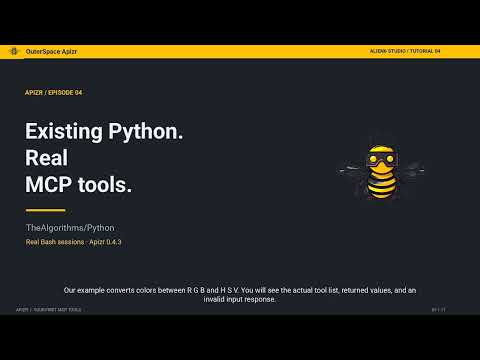

<p class="apizr-academy-kicker">Build a service · Lesson 04 · Plan about 25 min</p>

# Expose the same calculation as an MCP tool

A teammate wants an assistant to use the same price calculation. The business function should not change merely because the client protocol changes.

You will first discover and call the tools with a Python client. This lets you observe the actual tool contract and result separately from anything an AI model might say about them.

!!! abstract "By the end of this lesson"
    - Identify the tool names and input schema supplied by the server.
    - Distinguish a tool’s result from a model-generated answer.
    - Choose the process and interpreter an MCP client will start.

## Watch the lesson

<div class="apizr-demo-video">
  <a class="apizr-demo-video__cover" href="https://www.youtube.com/watch?v=rJThRd9vq4g" data-apizr-video="rJThRd9vq4g" data-apizr-title="Generate MCP tools and call them with Python" aria-label="Play: Generate MCP tools and call them with Python">
    
    <span class="apizr-demo-video__play"><span aria-hidden="true">▶</span> Watch the tutorial</span>
  </a>
</div>

English · 5:09 · The written steps below target 0.4.6 development; the recording keeps its original demonstrated version.

## 1. Reuse the shop selection

Keep the [prepared shop workspace](rest.md#1-keep-the-selection-explicit) from the previous lesson. Generate an MCP bundle for the same selected functions:

```sh
apizr expose build mcp shop --operator-policy operator.json --readiness-policy readiness-direct.json --policy exposure-direct.json --output-dir build/mcp
runtime/bin/python -m pip install -r build/mcp/requirements.txt
```

Inspect `build/mcp/mcp-tools.json`. Its business tools are `api.quote` and `inventory.available`. This server exposes your selected application functions. Apizr’s separate analysis MCP server inspects projects and has a different purpose.

## 2. Observe discovery and a real call

Run the [complete Python client](../getting-started/quickstart.md#test-with-python). It starts `build/mcp/server.py` with the selected runtime interpreter, discovers the two tools and checks their structured responses.

For the inputs used in the REST lesson, the business values are unchanged. The MCP adapter wraps the scalar values in structured results:

```json
{"result": 25.0}
```

Tool discovery describes available operations; it does not execute the price calculation. The subsequent `call_tool` operation makes that invocation.

## Practice

1. Run discovery and confirm that exactly the two selected business tools are listed.
2. Change the price-call inputs to `unit_price=12.5, quantity=3`. Predict the structured result, then observe it.
3. Before configuring an AI client, identify the absolute interpreter and server paths it must start. Explain what a failed process launch tells you about the price function itself.

??? success "Check your reasoning"

    The expected structured result is `{"result": 37.5}`. The protocol wrapper differs from the REST response, while the reviewed calculation is the same.

    A wrong interpreter or server path prevents the client from starting its MCP server. It is not evidence that the business calculation returned a wrong answer. Once the Python client works, configure your chosen AI client and review its actual tool calls. Model selection and authority to invoke tools remain explicit client decisions.

[Back to the Academy](index.md) · [Continue to the next lesson](oci.md)
