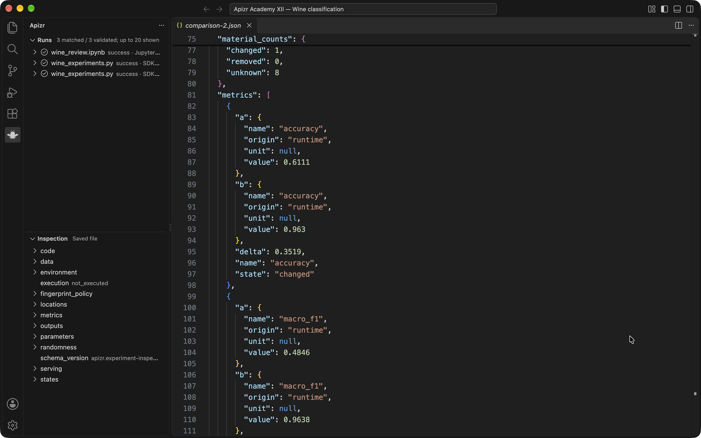

# XII — Review real experiment Runs in VS Code

<p class="apizr-academy-kicker">Track and review · Lesson 12 · Plan about 30 min</p>

!!! abstract "By the end of this lesson"
    - Navigate an actual Run and distinguish saved-source inspection from execution.
    - Interpret equal measured scores without inferring identical models or generalization.
    - Recognize stale source evidence and the Restricted Mode boundary.

## Watch the lesson

<div class="apizr-demo-video">
  <a class="apizr-demo-video__cover" href="https://www.youtube.com/watch?v=zkujF-thyyQ" data-apizr-video="zkujF-thyyQ" data-apizr-title="Review real experiment Runs in VS Code" aria-label="Play: Review real experiment Runs in VS Code">
    
    <span class="apizr-demo-video__play"><span aria-hidden="true">▶</span> Watch the tutorial</span>
  </a>
</div>

<!-- recording-transcript -->


Train two decision trees on the [UCI Wine dataset](https://archive.ics.uci.edu/dataset/109/wine),
then review their measured results in Apizr for VS Code. The dataset contains
178 real wine samples, 13 chemical measurements and three cultivar classes;
it is bundled with scikit-learn. Credit: S. Aeberhard and M. Forina,
[Wine (1992)](https://doi.org/10.24432/C5PC7J), CC BY 4.0.

The images show the actual 0.4.6 development extension and locally executed Runs.

## 1. Prepare the example

Use a checkout of Apizr's `0.4.6` development branch, Python 3.14, uv and the
[development VSIX](../reference/vscode.md). From the repository root, copy the
example into a fresh directory:

```sh
cp -R examples/tracking/wine-vscode /tmp/apizr-wine
uv venv /tmp/apizr-wine/.venv --python 3.14
uv pip install --python /tmp/apizr-wine/.venv/bin/python \
  '.[notebook]' -r /tmp/apizr-wine/requirements.txt
cd /tmp/apizr-wine
.venv/bin/apizr init .
.venv/bin/python wine_experiments.py
```

This installs the selected development checkout. The scientific dependencies
belong to the example's environment, independently of the extension's managed CLI.

The script exports the dataset to `wine.csv`, uses the same stratified 70/30 split
and seed `42`, and executes trees with `max_depth=1` and `max_depth=3`. Each SDK
session records the input's content identity, the two parameters and the computed
accuracy and macro F1, rounded to four decimal places before logging.

## 2. Connect the extension

The policy created by `init` allows source inspection. Add read access to this
project's history and select the example's Python environment:

```sh
.venv/bin/python - <<'PY'
import json
from pathlib import Path

root = Path.cwd().resolve()
policy = root / ".apizr/operator.json"
document = json.loads(policy.read_text())
document["grants"].append({
    "adapter": "experiments", "operation": "history.read",
    "target": {"kind": "local", "root": str(root)},
    "store": ".apizr/experiments/v1", "permissions": ["experiments.read"],
})
policy.write_text(json.dumps(document, indent=2) + "\n")
(root / ".vscode").mkdir(exist_ok=True)
(root / ".vscode/settings.json").write_text(json.dumps({
    "apizr.engine.mode": "python",
    "apizr.engine.python": str(root / ".venv/bin/python"),
    "apizr.operatorPolicy": str(policy),
}, indent=2) + "\n")
PY
code .
```

Trust this example folder, then run **Apizr: Check engine**. Open the Apizr bee,
choose **Open experiment dashboard**, then **Refresh history**. Opening the view
alone does not start an engine or load the store.


The captured session contains the two SDK Runs plus a real Jupyter Run from
step 5. Run identities and timestamps will differ in your own session.

## 3. Read a Run

Select a Run's digest in the dashboard. Read its capture mode, `max_depth`,
`random_state`, `accuracy` and `macro_f1`. **Open complete JSON** preserves the
canonical Plan and Run, including input fingerprints and unknown evidence.
**Open recorded source** opens the current source file.

This short GIF sequences captured views of the running extension:


In the captured execution:

| Capture | `max_depth` | Accuracy | Macro F1 |
| --- | ---: | ---: | ---: |
| SDK | 1 | 0.6111 | 0.4846 |
| SDK | 3 | 0.9630 | 0.9638 |
| Jupyter | 5 | 0.9630 | 0.9638 |

This Wine example records the selected input, parameters and metrics; it does not
select a saved model artifact. A model fingerprint is therefore not available
from these Runs merely because they contain scores.

These are observations on one held-out split. Depths 3 and 5 give the same scores
here. This comparison does not establish performance on another dataset or
approve a deployment.

## 4. Inspect and compare

Open `wine_experiments.py` and choose **Apizr: Inspect with Apizr**. Expand the
**Inspection** view to follow the engine's evidence and source locations.
Inspection reads saved source; it does not fit a model. Editing the file marks
that evidence outdated until you explicitly inspect the saved file again.


Choose **Compare two Runs**, selecting the depth-1 SDK Run as A and the depth-3
SDK Run as B. Read the observed parameter change, the Wine input identity and
the metric deltas in the canonical comparison. Reverse A and B to reverse the
deltas. Unknown evidence remains unknown.



## 5. Add a real notebook Run

Open `wine_review.ipynb` in a Jupyter-capable editor, select the example's `.venv`
kernel and execute its two code cells. The last cell fits the depth-5 tree and
logs its measured scores through the same function and history store. Refresh
history to see its **Jupyter** capture mode alongside the SDK Runs.

Apizr does not install or replace a notebook kernel. Its notebook-toolbar
inspection action reads the saved notebook without executing any cells. A cell
identity and execution count do not describe every value in live kernel memory;
continue with the [Jupyter tracking lesson](index.md#11-capture-real-jupyter-cells)
for that distinction.

**Try it:** repeat the depth-5 cell. Confirm that another Run appears with a new
identity and execution count. Compare its scores and retained input identity with
the previous execution before drawing a conclusion.

[Extension settings and limits](../reference/vscode.md) ·
[Tracking guide](../getting-started/tracking.md) ·
[Example source](https://github.com/Alien6-Studio/outerspace-apizr/tree/0.4.6/examples/tracking/wine-vscode)

## Restricted Mode in the recording

At **04:30**, a second dedicated profile opens the Wine workspace in Restricted Mode. The dashboard can be shown, but **Check engine** reports `workspace_untrusted` and starts no engine. This is a distinct refusal from a stale saved-source view. In manual practice, use a separate untrusted window/profile to observe it, then make any trust decision explicitly. The operator policy remains a separate boundary after workspace trust.

## Practice: explain the comparison

1. Use the video’s pause question at **05:05**: the SDK depth-3 and Jupyter depth-5 Runs have equal rounded scores. Does that establish equal generalization? What would you check before preferring either model?
2. Use **Open complete JSON** to read the actual input identities, parameters, capture details and missing evidence. If no model artifact was explicitly selected, do not invent a recorded model identity from the score. Repeat the notebook cell and inspect the new Run and execution count.
3. Add an unsaved comment, as in the recording, and observe the stale-result indication. Inspect again and check that it still reads the saved file; then revert the comment. Explain why refreshing the history is a read operation and does not rerun training.

??? success "Check your reasoning"

    Equal rounded accuracy and macro F1 on this one held-out split do not establish identical model bytes or equivalent generalization. Read the actual input identities, parameters, capture details and evaluation setup.
    A model identity remains unknown when no model artifact was selected.

    A history refresh reads retained records. It does not retrain, replace an old Run or silently prove that the current file is its recorded source. Read the stale-evidence explanation before choosing the next operation.

[Back to the Academy](index.md) · [Continue with the tracking reference](../reference/tracking-sdk.md)
