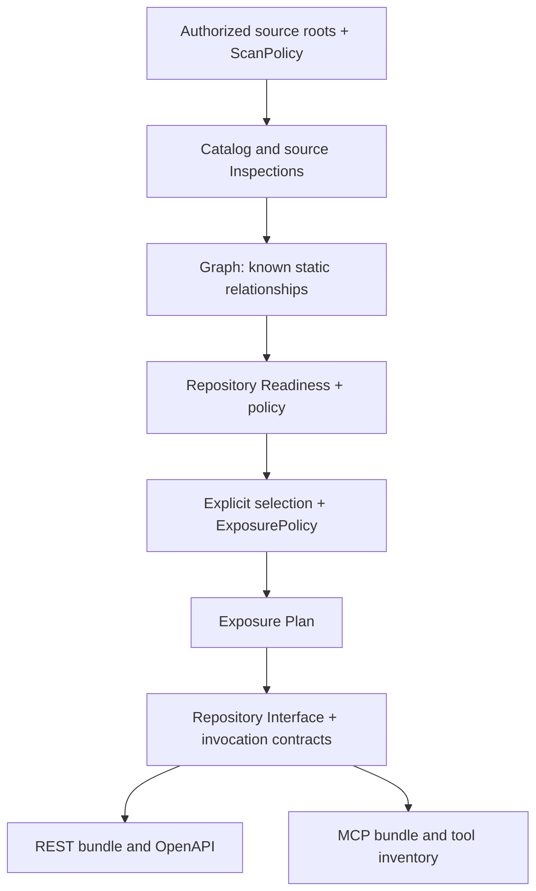
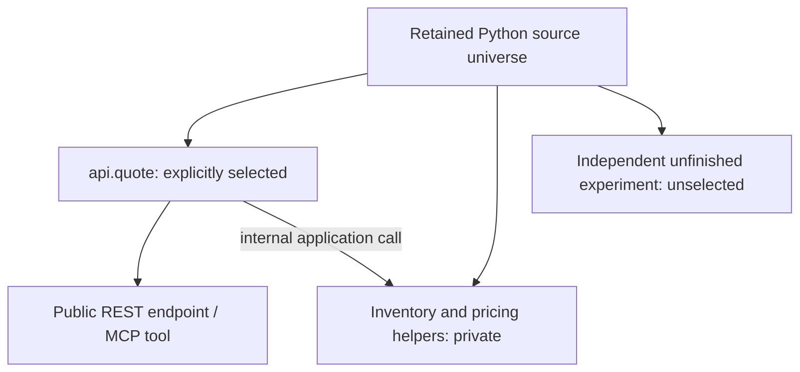

# From source to interfaces

Trace which evidence is required to publish a function, and which source is
retained without becoming public. The result is a reviewed interface selection
whose contracts are linked to the exact analyzed source.

Read [Components and responsibilities](system-boundaries.md) first. For runnable
commands, use [Compile a business project from Python](../developer-guide/compiler.md).
The diagrams describe that repository workflow rather than introducing another API.

## Discover, assess, select, render

1. The [scanner](repository-scanner-v1.md) inventories bounded `.py` sources.
   Each eligible source carries an [Inspection](capability-ir-v1.md) describing
   statically discovered top-level functions. Single-source inspection separately
   supports Python files and notebooks.
2. The [Graph](capability-graph-v1.md) records the relationships it can establish
   statically. Unknown imports, calls or effects remain evidence of uncertainty;
   analysis does not resolve them by importing the project.
3. [Repository Readiness](repository-readiness-v1.md) assesses that evidence
   under a policy. A ready function is eligible under the contract; it has not
   been selected, authorized for execution or deployed.
4. The [Exposure Plan](exposure-plan-v1.md) combines an explicit selection with
   required evidence, interface choices and compatible execution modes. A refusal
   stops publication of that selection; generation does not silently choose a
   different backend or expose a different function.
5. The [Repository Interface and bundle](repository-bundle-v1.md) carry selected
   invocation contracts, retained source and upstream evidence. REST and MCP
   rendering share this selection while emitting their own transport contracts.

The public compiler API's `prepare_exposure` retains one analyzed context.
`render_bundle` can render REST and MCP from that context without rereading a
new source revision. Preparing a changed revision is a new explicit action.

## Public selection is narrower than retained source

For the [quote example](../examples/business-quote.md), the public name is
`api.quote`, and its capability ID is `python:api:quote`. Qualified public names
distinguish functions that share a bare name in different modules. Only explicit
Exposure Records become endpoints or tools.

Bundling the scanned Python universe enables verified package imports and private
helpers. It does not expose all bundled functions or prove complete dependency
closure. An independent unfinished experiment can remain unselected; a defect
in a dependency required by the selected function can still block its exposure.
The [research example](../examples/research-serving.md) demonstrates that distinction.

## Keep application inputs separate from static discovery

Third-party packages and data files are not discovered into a runnable environment
by static analysis. [Explicit application inputs](../getting-started/user-guide/project.md#application-dependencies-and-resources-041-development)
bind reviewed dependency pins and selected resources to the repository. Resource
paths, sizes and hashes describe captured bytes; they do not imply that every
file accessed dynamically at runtime has been found.

The [single-source REST](rest-generator-v1.md) and [MCP](mcp-generator-v1.md)
generators have their own supported path from Inspection and source-local
readiness. They do not require a repository Exposure Plan or an Experiment Run.
The historical pipeline remains a separate [compatibility path](legacy-behavior-contract.md).

## Verify the architectural result

Inspect `openapi.json` or `mcp-tools.json` before starting the service. Confirm
the selected public names, their input contracts and the absence of private
helpers. Review the bundle's retained source and requirements separately; a
generated contract proves neither a successful call nor a running deployment.

Continue with [Experiments and artifact identities](experiments-and-artifacts.md)
for the optional evidence path and the meaning of the bindings between artifacts.
