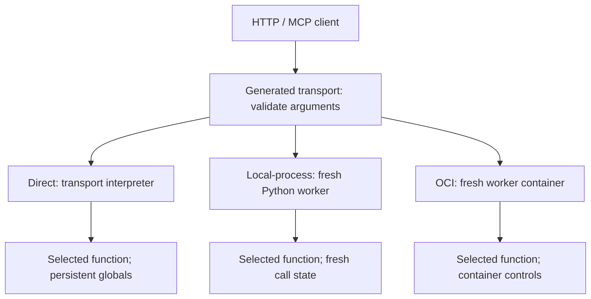
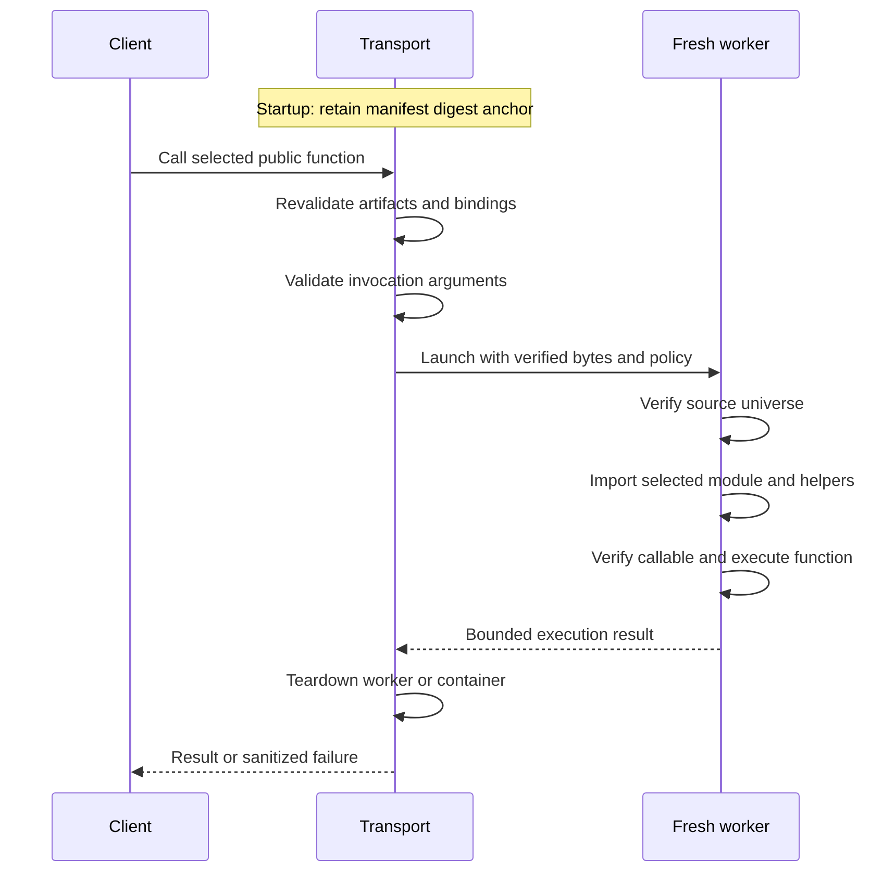

# Request and execution boundaries

Identify where a request is validated, where application code is imported and
which controls apply to its execution. The result is an execution choice that
matches your application's state and operating requirements.

Read [Experiments and artifact identities](experiments-and-artifacts.md) first.
For runtime setup, follow [Choose execution controls](../operations-guide/execution.md).
All three modes below execute trusted code and dependencies.

## Choose the boundary explicitly

The diagram shows alternative configured modes, not three attempts for one
request. Planning checks compatibility for every selected function. A missing
backend, unsupported control or incompatible runtime image is a refusal; Apizr
does not retry through direct execution.

| Mode | Where project code runs | State and controls | Operating limit |
| --- | --- | --- | --- |
| Direct | Generated transport interpreter | Imports, globals and mutable defaults can persist across calls | No fresh worker or governed timeout boundary |
| Governed local-process | Fresh Python process per invocation | Input/output bounds, wall timeout, controlled environment, fresh working directory, process-group cleanup | Host filesystem and network remain accessible; no general sandbox |
| Governed OCI | Fresh container per invocation | Reviewed network, filesystem, privilege and resource controls; read-only bundle and unconditional teardown | Requires the exact prepared image/platform/protocol; container isolation is not a VM |

## A governed call verifies before importing

At startup, a [governed repository transport](governed-repository-runtime.md)
validates the bundle and backend and retains its manifest digest as an anchor.
Before every call, it checks artifact hashes and source/interface/plan/policy
bindings against that anchor. A mismatch stops the invocation before a project
worker is launched.

The transport never installs the project importer or imports selected/support
project modules. Only the worker installs the verified `RepositoryLoader` and
imports the selected module, including required package initializers and private
helpers. Unrelated retained modules are checked without executing their source.
Import-time application code therefore runs inside the worker boundary.

The worker uses the shared invocation contract for arguments, sync/async calls
and finite JSON output. The runtime bounds results and sanitizes failures.
Source exceptions, stderr and internal paths are not returned to clients. A
timeout is distinguished from ordinary failure; OCI OOM classification requires
the provider's positive OOM evidence, not merely exit code 137.

These integrity checks assume a trusted initial bundle. Replacing the entire
bundle before startup is not prevented by a digest that arrives with it; publisher
authentication is a separate trust decision.

## Match the runtime image to the contract

Governed repository OCI requires an immutable image ID, an explicit Linux
platform and the repository worker protocol label. A single-source-only worker
image is insufficient. The provider does not resolve tags, pull an image or
fall back to a local process to make the call succeed.

The original OCI contract's PID limit does not prohibit subprocess creation.
The opt-in [strict subprocess-deny profile](subprocess-deny.md) uses a distinct
worker protocol and installs restrictions before project import. Choose the
actual contract and its prerequisites rather than inferring stronger isolation
from the word "container".

A direct service packaged in an OCI image is a persistent service container.
It is a different boundary from the fresh governed OCI container created for
each function call. The next chapter illustrates that distinction.

Check the selected policy, installed application dependencies and worker image
before starting a service. For exact failure mappings and artifact schemas,
use the [repository runtime contract](governed-repository-runtime.md),
[single-source governed contract](governed-transport-runtime-v1.md) and
[OCI transport contract](governed-oci-transports-v2.md). Continue with
[Extensions and service delivery](extensions-and-delivery.md).
