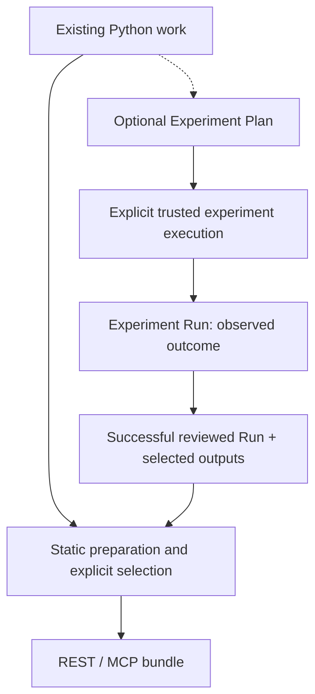
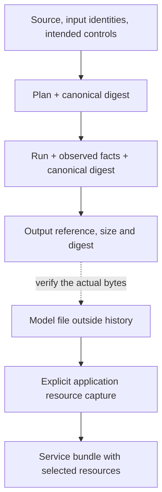

# Experiments and artifact identities

See how experiment evidence can inform service generation without becoming a
requirement for exposing an existing function. The result is a design that keeps
intended controls, observed facts and application files distinct.

Read [From source to interfaces](compilation-flow.md) first. The concrete
examples are [Compare fraud experiments](../examples/compare-fraud.md) and
[Share a prediction](../examples/share-prediction.md).

## The experiment path is optional

An [Experiment Plan](experiment-evidence-v1.md) records intended source, inputs
and controls. The Run records what the selected execution observed, including
its outcome and any explicitly captured metrics or outputs. Static inspection
can identify a metric signal without measuring its value.

Trusted local experiment execution runs the workload in the chosen environment;
it is not the governed per-request worker and does not provide a sandbox.
Scientific dependencies must already be installed in that workload environment.

The [experiment exposure bridge](../getting-started/user-guide/experiment-exposure.md)
requires a successful matching Run, explicit function selection and reviewed
output/dependency choices. It verifies the recorded source and selected output
bytes before generating a direct service. A captured notebook is converted for
that compiler path; repository scanning itself still inventories `.py` sources.
The bridge does not expose the training routine or every function in the notebook.

You can instead expose an existing function with its own explicitly supplied
resources and dependencies. No Plan or Run is needed for that direct workflow.

## A history record is not a model store

Local history retains validated JSON records and artifact identities. It does
not automatically retain model bytes, datasets or a complete Python environment.
Deleting `model.pkl` cannot be repaired by a Run that records its SHA-256.
Preserve required files separately using the
[evidence retention procedure](../operations-guide/evidence.md).

Input origins, selected seed controls, environment evidence, metric signals and
runtime observations have different contracts. The detailed chapters explain
[inputs](../guides/experiment-inputs.md),
[seeds and environment](../guides/experiment-randomness-environment.md), and
[metrics and outputs](../guides/experiment-results.md). An unknown value remains
unknown; recording a declared seed does not prove reproducibility.

## Bind the evidence without overstating its meaning

Canonical serialization gives equal artifact content equal bytes and digests.
A Run binds its exact Plan and source identity; compiler and bundle artifacts
bind their upstream evidence and retained files. Changing those bytes requires
new matching evidence rather than editing a digest to bypass validation.

A digest establishes byte identity and cross-artifact integrity. It is not a
publisher signature, an operator grant, proof of a supervised build or evidence
that a scientific conclusion is valid. Those boundaries are documented in
[Artifact principles](artifact-principles.md) and
[Delivery identities](delivery-identities.md).

Comparing two validated Runs reports differences in their recorded facts. It
does not infer why a metric changed. In the fraud example, inputs and seeds can
be held constant while parameters and measured results differ; the diff remains
a comparison, not a causal explanation.

Check that your selected Run, source and model file still match before sharing
a prediction. Then continue with [Request and execution boundaries](execution-boundaries.md).
