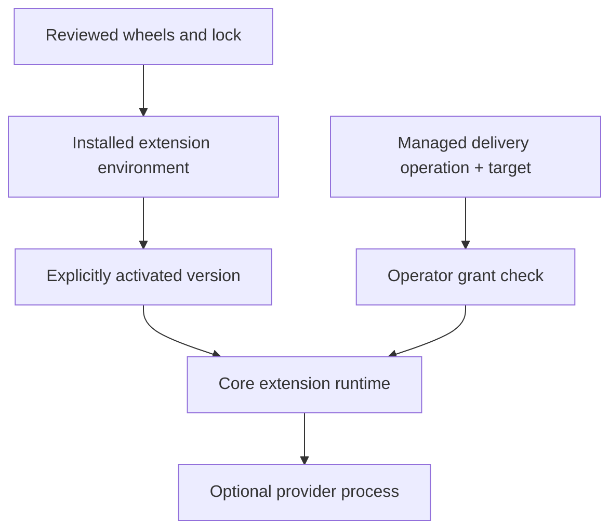
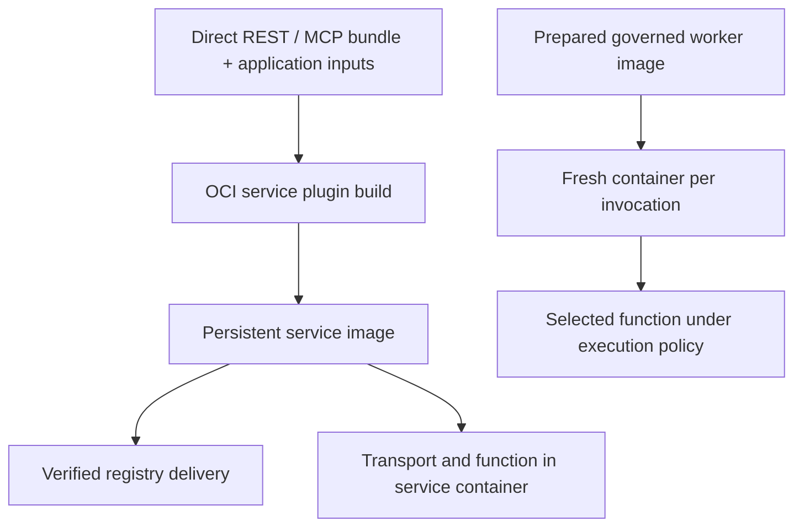
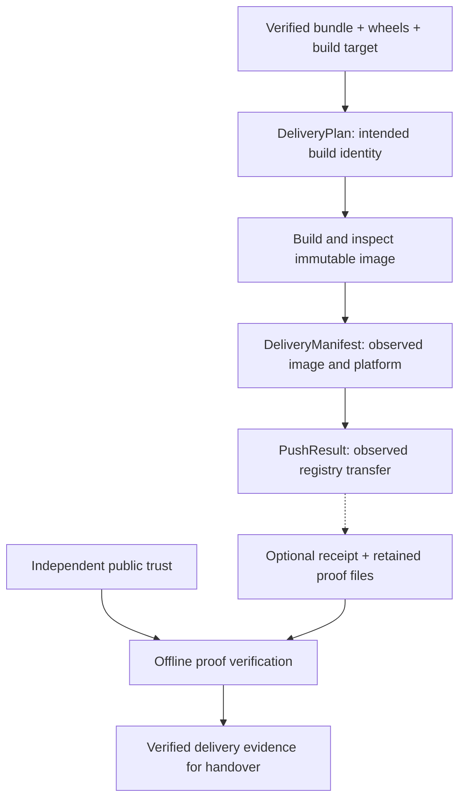

# Extensions and service delivery

Trace how optional providers turn a reviewed bundle into an image and a
verifiable handover. The result is a delivery design that preserves the
distinction between installed tools, operation authority and deployment approval.

Read [Request and execution boundaries](execution-boundaries.md) first. The
[verifiable service example](../examples/verified-delivery.md) supplies the
complete disposable registry and optional Attest exercise.

## Installation, activation and authority are separate

Core plugin management stores and validates reviewed extension bytes in a
separate environment. Activation selects an installed version. The operator
policy authorizes managed build, registry publication and signing operations
for an exact target before the core launches the extension or accesses its
operational credentials. These managed operations are the path shown below.

The diagram's two inputs to the runtime are both required. An installed plugin
does not grant access to an arbitrary repository, registry, signing key or
destination. A project plugin declaration is a reproducible installation input,
not an operator permission. Verification and other operations keep their own
documented requirements. The low-level extension API invokes an explicitly
trusted program without managed installation identity or operator authorization;
it does not install, discover or activate plugins.

| Optional provider | Responsibility | Detailed interface |
| --- | --- | --- |
| `outerspace-apizr-mcp` | Serve authorized repository analysis; optionally configured delivery tools | [Analysis MCP server](../reference/apizr-mcp-server.md) |
| `outerspace-apizr-oci` | Prepare/build a service image and verify its registry transfer | [OCI service images](../reference/oci-service-plugin.md) |
| `outerspace-apizr-attest` | Sign, timestamp and verify the documented delivery proof | [Attest delivery proofs](../reference/attest-delivery-plugin.md) |

The modern [extension invocation protocol](../reference/extension-invocation.md)
is separate from [historical pipeline plugins](../getting-started/developer-guide/plugins.md).
The [extension guide](../developer-guide/extensions.md) demonstrates a minimal
modern provider without modifying Apizr's own core domains.

## A service image is not a per-call worker image

Building a service image does not enable governed per-call OCI execution.
The service plugin packages a direct bundle, transport requirements and
explicit application inputs. A governed worker image implements the required
execution protocol and contains its own prepared application dependencies.
Use [Operations → execution](../operations-guide/execution.md) to choose the
invocation boundary and [Operations → delivery](../operations-guide/delivery.md)
to package and transfer a service.

## Follow the planned and observed identities

The [DeliveryPlan](delivery-identities.md) binds validated upstream compiler
evidence, bundle artifacts, application inputs, inspected wheel identities and
build target. It contains intended inputs, not an observed image, destination
or receipt. The **DeliveryManifest** binds that Plan to observed image ID,
platform and build-input identity. Changing a destination does not change the
manifest of an already built image.

The **PushResult** records the separately verified transfer. Optional Attest
proofs bind the documented build/push observations and manifest to a signed,
timestamped receipt. Offline verification uses retained public proof files and
independently configured public trust; it does not require a private key or
contact the registry.

Verification authenticates the recorded evidence and its links. It does not
repeat source analysis, rerun the build, inspect a live image or prove that
Attest supervised the build. A valid receipt does not establish model quality,
scientific validity or organizational permission to deploy.

## Finish with the appropriate handover

Review the immutable image reference, platform, observed transfer and any
required verified proof. [Proof-required admission](../reference/delivery-admission.md)
has its own explicit requirements and separately authorized final promotion.
[Multi-destination delivery](../reference/multi-destination-delivery.md) retains
independent outcomes and can explicitly resume delivery of one immutable build.

External platforms apply their own authenticated approval and deployment
mechanisms to the [exported documents](../reference/external-governance.md).
Apizr does not supply an organizational approval console or a native rollback
command. The [Operations guide](../operations-guide/index.md) provides the
procedures; the contract sections in this architecture guide provide exact
schemas, bindings and limits.
