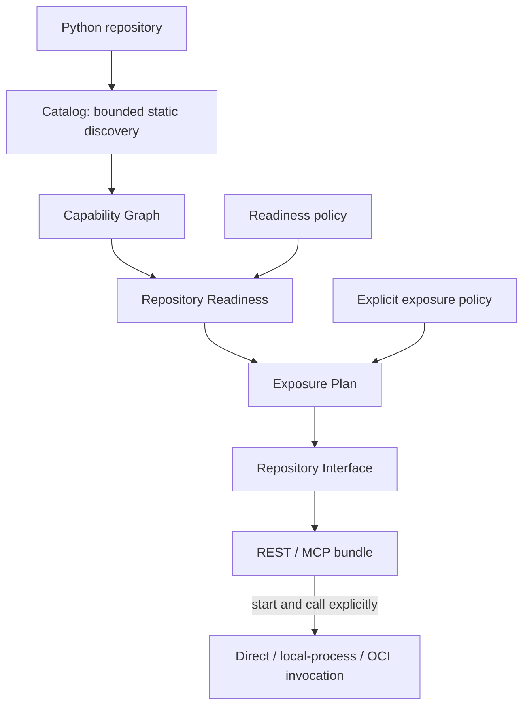

# Capability Compiler architecture

Apizr inspects Python work, records and compares trusted experiment evidence,
and exposes selected functions through REST/MCP. An existing function can be
compiled directly; the optional experiment path adds recorded context rather
than becoming a generation prerequisite.

This is the first chapter of the [Architecture guide](index.md). Read the
[components chapter](system-boundaries.md) next to separate the compiler,
generated services and optional extensions.

The repository compilation path is:

The stages above generation inspect evidence without executing project code.
The runtime stage executes the selected trusted function under its chosen
contract. An Experiment Run can supply additional context, but is not an input
required by this repository compilation path.

## Discover and understand

The [scanner](repository-scanner-v1.md) inventories Python files without importing
or executing them. [Capability IR](capability-ir-v1.md) describes top-level function
contracts and [Graph](capability-graph-v1.md) records statically known relationships.
Individual inspection also accepts notebooks. Neither stage installs dependencies.

## Assess and select

[Repository Readiness](repository-readiness-v1.md) combines Catalog, Graph and policy
evidence. **READY does not mean exposed**: eligibility is evidence, not publication,
authorization or a runtime safety guarantee. Unknown effects remain unknown.

[Exposure Plan](exposure-plan-v1.md) binds that evidence to the operator's explicit
selection, interfaces and allowed execution contracts. It never exposes dependencies
transitively. Selected A may call private helper B without B becoming public.

## Generate repository interfaces

[Repository Interface and bundles](repository-bundle-v1.md) bind each selected
capability to the shared invocation contract and exact Python source universe.
Qualified public names distinguish functions with the same bare name. Verified
imports support packages, relative imports and private helpers. Bundling the scanned
universe does not prove complete runtime dependency closure or include data files.
Generation remains static, deterministic and atomic. Digests are reviewable integrity
evidence, not publisher signatures.

## Execute explicitly

[Governed repository execution](governed-repository-runtime.md) adds independently
versioned plans and bridges without changing the public transport contract.

| Mode | Boundary | State | Controls |
| --- | --- | --- | --- |
| Direct | Transport process | Persists | Trusted in-process invocation |
| Local-process | Fresh process per call | Resets | Time/input/output bounds, environment, fresh directory, process-group cleanup |
| OCI | Fresh container per call | Resets | Reviewed network/filesystem/privilege/resource controls and teardown |

Governed transports validate all artifacts before each call and never import project
source. Only the worker installs the verified RepositoryLoader. Backend compatibility
must hold for every selected capability; unavailable backends refuse without fallback.
OCI requires an immutable image ID/platform and the repository-worker protocol label.

Local execution is not a filesystem/network sandbox. OCI is not a VM or a
guarantee for untrusted code; its optional [strict profile](subprocess-deny.md)
prohibits process/thread creation before project import. Both require trusted code,
dependencies and infrastructure. Application dependencies remain a deployment concern.
No RBAC, approvals, identity service or enterprise control plane is included.

## Existing workflows and contracts

The [single-source REST](rest-generator-v1.md), [MCP](mcp-generator-v1.md),
[local execution](execution-policy-v1.md) and [OCI](oci-container-runtime-v1.md)
workflows remain supported. The [legacy pipeline](../getting-started/user-guide/apizr.md)
is independent and retains its [documented limitations](legacy-behavior-contract.md).
Canonical artifacts retain their versioned contracts.

Explicit [application inputs](../getting-started/user-guide/project.md#application-dependencies-and-resources-041-development)
add selected resources and exact dependency pins to direct service bundles.
The [experiment bridge](../getting-started/user-guide/experiment-exposure.md)
selects matching outputs/dependencies from a successful Run using those contracts.

See the [release notes and known limitations](../releases/0.4.5.md).
