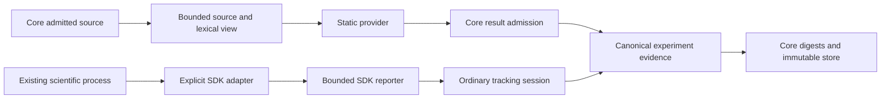

# Scientific providers and SDK adapters v1

!!! note "0.4.6 development"

    These contracts are implemented on `0.4.6` and are not yet published.
    The official built-in recognizers ship in the core and remain active by default.
    Provider selection and stored producer inventory remain separate milestone work.
    Existing inspection behavior and stored evidence stay unchanged.

Static recognition and in-process observation have different authority. A static
provider sees bounded source and returns candidates. An SDK adapter receives an
explicitly selected object inside the user's existing scientific process and
reports selected observations through the tracking SDK. Neither owns the evidence
store, experiment digests or publication.



## Static contract and source authority

`apizr.scientific_providers` exports `ProviderDescriptor`, `ProviderRequest`,
`ProviderResult` and the structural `StaticProvider` protocol. A provider declares
a stable lowercase identity, an opaque bounded implementation version and one or
more capabilities. A version identifies the producer implementation; it is not
proof that a scientific distribution was installed or executed.

| Capability | Existing result type | Meaning |
| --- | --- | --- |
| `metric_signals` | `MetricDiscoveryResult` | Located lexical metric-call signals, without metric values |
| `output_candidates` | `OutputDiscoveryResult` | Located output declarations, without observed file bytes |
| `randomness_controls` | `RandomnessResult` | Static literal controls or explicit unknown values |
| `input_reads` | `InputResult` | Static input references or unknown candidates, without content observations |

`experiments.provider_source.SourceView` admits project-relative references and
UTF-8 Python source through the existing `_lexical.py` parser. Its digest is
computed by the core from the exact UTF-8 bytes. `tree()` supplies a fresh bounded
AST, so a provider cannot mutate a shared compiler tree. `SourceLexicalVisitor`
reuses the existing conservative scope and alias authority; each provider supplies
explicit import-name allowlists. Shadowing, star imports and unsupported generic
scopes do not establish call authority. No scientific package is imported.

This v1 view deliberately reparses when producing a detached AST. Shared parsing
optimization belongs to the later performance work; no global mutable cache is
introduced. The source text is transient input to explicitly selected trusted
recognizers, not an additional stored evidence artifact. It grants no project
root, file-read, network or execution authority.

| Core hard ceiling | Value |
| --- | --- |
| Source UTF-8 bytes | 1 MiB |
| AST nodes / depth | 100,000 / 128 |
| Aggregate returned evidence items | 256, with the existing 128-control randomness ceiling |
| Aggregate diagnostics | 512 |
| Complete serialized result | 1 MiB |

`ProviderLimits` may lower these bounds. The request applies the declared source
ceilings before recognition. Strict models reject coercions, unknown fields,
incompatible schema versions, duplicate capabilities and non-finite values.

## Result admission, origins and unknowns

Every result, including a result from a built-in provider, goes through
`admit_result(result, request=request)`. Constructing `ProviderResult` alone does
not admit evidence. Admission checks producer identity and version, the exact
source reference and its core-computed digest, declared capabilities, aggregate
bounds and canonical evidence types. It revalidates already constructed or
tampered model instances.

Static providers cannot supply runtime metrics, input digests, file sizes or
observed input-content origins. Existing static metric and output signals retain
`static` origin. Randomness and input candidates retain `static` or `unknown` as
appropriate. Unknown is not a successful observation of absence and never gains
an invented value. Literal controls do not prove execution, determinism,
reproducibility or scientific causality. See the
[experiment evidence contract](experiment-evidence-v1.md).

`ProviderDiagnostic` carries a fixed code, `unknown` origin, optional declared
capability and `ProviderLocation`. The source reference is required; line and
column are either both present or both unknown. Lines are one-based and columns
are zero-based UTF-8 byte offsets. Admission checks all returned signal and
diagnostic locations against the selected source. Locations follow Python's
LF, CRLF and CR physical lines; other Unicode separators inside
strings or comments do not create positions on additional source lines. Admission
checks correspondence and evidence bounds, without independently proving a
provider's scientific interpretation. Existing section diagnostics
may have an unknown location; a claimed position must name the selected source.
Raw exception messages, stderr, library objects and free-form provider messages
do not enter these diagnostics. Admission failures expose only
`provider_result_invalid`.

## Out-of-tree extension protocol

The payload schemas are `apizr.scientific-provider/v1`,
`apizr.scientific-request/v1`, `apizr.scientific-source/v1` and
`apizr.scientific-result/v1`. They are operation payloads inside the existing
**`apizr.extension/v1`** envelope, not a second plugin protocol or loader.

| Existing envelope operation | Operation-specific payload |
| --- | --- |
| `scientific.describe` | Empty arguments; a static `ProviderDescriptor` or `SDKAdapterDescriptor` result, distinguished by its schema |
| `scientific.recognize` | `extension_arguments(request)`; a `ProviderResult` result |

The caller chooses an already installed, explicitly approved extension through
`plugins.local.run_extension`, then calls
`admit_extension_response(response, request=request)`. Low-level explicitly
trusted callers may use `extension_runtime.invoke_extension`. Request ids,
operation correlation, finite JSON, output bounds, deadlines, cancellation and
process cleanup remain the existing runtime's responsibility. Choose envelope
request limits large enough for the serialized source and descriptor, and output
limits no larger than the admitted result ceiling. No install, discovery or
activation occurs on import or during admission.

An in-process provider is trusted core code; AST bounds do not stop it from
looping. An out-of-tree process uses existing supervision, which is not a sandbox.
Extensions run with the user's permissions. Selection, precedence and diagnostics
for unavailable or incompatible providers belong to the separate provider
selection work; these contracts add no implicit fallback.

## In-process adapter contract

`SDKAdapterDescriptor` has the separate schema `apizr.scientific-adapter/v1` and
declares `parameter`, `metric`, `input` and/or `artifact` reporting capabilities.
Its observation mode is exactly `explicit-in-process-values`. `SDKAdapter.observe`
receives one explicitly supplied object and the structural `SDKReporter` surface.
Adapters may import the scientific library in that existing workload environment.
They choose library-supported observations; the core never traverses the object,
pickles it, calls its representation or searches notebook namespaces.

```python
from apizr import tracking
from apizr.scientific_providers import ProducerIdentity, SDKAdapterDescriptor
from apizr.tracking.adapters import AdapterReporter

reporter = AdapterReporter(
    SDKAdapterDescriptor(
        identity=ProducerIdentity(name="example.adapter", version="1.0"),
        capabilities=("metric",),
    )
)
with tracking.session(root=project_root):
    reporter.log_metric("accuracy", explicitly_selected_score)
```

The reporter exposes only the SDK's four logging calls. It has no store, project
root, Run creation or `finalize` method. Undeclared reporting capabilities are
refused. Each call uses the current ordinary session, including context ownership,
runner/serving suppression, item and capture bounds, failed-capture behavior and
`experiments.values` validation. Recursive JSON remains bounded to depth 16,
4,096 nodes and 64 KiB per value, with finite numbers and no arbitrary objects.
The session retains its 256-item section bounds and 1 MiB aggregate capture bound.
Only the core fingerprints explicitly selected input/output files and publishes
the completed canonical record.

Optional adapters are separately packaged extensions. Their metadata can use
`scientific.describe` under the existing extension lifecycle. The user explicitly
imports and invokes their observation code in the scientific process; an isolated
extension child cannot inspect live in-memory workload objects. The compiler never
imports that code, and this contract introduces no in-process entrypoint discovery.
A narrow reporter is an API boundary, not a security sandbox for trusted Python
code. Producer inventory in stored Runs is subsequent selection work.

## Ownership and qualification

`experiments.provider_source` owns source admission and the supported lexical
view, including the supported bounded parser, limits and parse-limit diagnostic.
`scientific_providers/contracts` owns descriptors, requests, untrusted candidate
results and admission over canonical evidence. `tracking.adapters` owns the
reporter delegating to the ordinary SDK. `plugins/*` continues to own installation,
activation and lifecycle; `extension_runtime` continues to own the process envelope.
The dependency inventory declares these edges without moving plugin management
into an optional scientific SDK or allowing evidence-store publication by providers.

### Official built-in provider

`scientific_providers/builtin` owns all existing library-specific recognition as
whole units: sklearn metric occurrences, joblib dump candidates,
pandas/numpy/joblib literal input reads, seed/random-state controls and scientific
import candidates. The occurrence-location observers move with those rules so
notebook cells keep their original positions. The provider uses the core's public
lexical view and canonical result types without importing scientific packages,
reading candidate files or executing workload code.

`BuiltinProvider` implements `StaticProvider` with identity `apizr.builtin`,
implementation version `1`, and all four static capabilities. Its `recognize`
method accepts a request for any declared subset and returns admitted results,
enforcing the request's aggregate bounds. It rejects another producer identity.
The compatibility `experiments.discover_*` operations delegate to the same rules
and retain their historical individual limits (256 inputs, metrics and outputs;
128 randomness controls), invalid-source diagnostics and Python-encoded byte
input support. They do not acquire the aggregate limits of a new combined request.
Provider selection will compose these contract requests in the subsequent work.

The core retains explicit declarations and metric values, input/output byte
observations, literal parameters, main guards and immutable publication. Closed
v1 callable/distribution refinements stay in their canonical result models.
Filename suffix hints stay with generic input selection: a `.npy` or `.joblib`
hint describes a file format without recognizing or importing a library API.

Ten byte-for-byte JSON/text golden artifacts were frozen before extraction at
`62f3ec7b` and retained under `tests/fixtures/experiments/builtin-baseline`, with
their sizes and SHA-256 manifest. Relocated Python/notebook fixtures and the
fraud-detection example must reproduce those exact bytes. The existing coverage
gate includes every module under both `experiments/` and `scientific_providers/`:
moving the rules does not remove their 100% line / 95% branch requirement.

The contract tests exercise canonical type reuse, source/identity mismatches,
tampered instances, strict capabilities, UTF-8 and AST limits, aggregate limits,
located unknown diagnostics and the existing extension envelope. Adapter tests
exercise ordinary publication, failed non-finite/oversized values and opaque
objects. `scripts/scientific_contract_proof.py` also runs with the installed
candidate wheel from an external directory in the existing wheel qualification.
It proves contract admission, SDK reporting and default built-in inspection with
all four capabilities, without a scientific-library integration or extension
selection policy.
