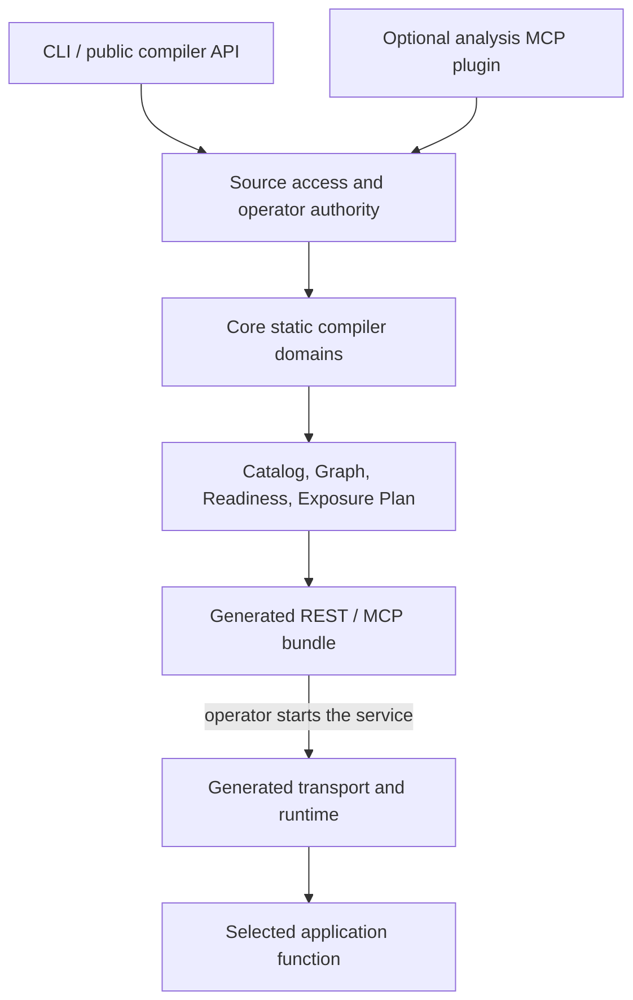
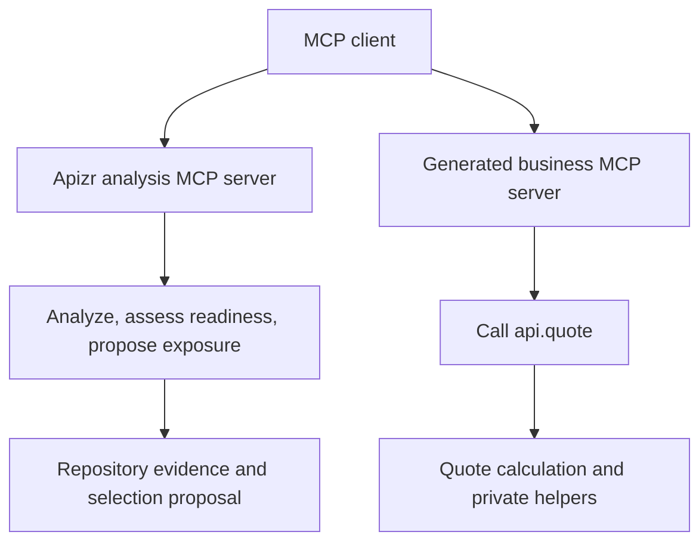

# Components and responsibilities

Locate the component that reads, generates or executes your work. The result is
a system design in which source analysis, public interfaces and runtime
dependencies have explicit owners.

Read [the overview](overview.md) first. This chapter uses the
[business quote](../examples/business-quote.md): `api.quote` is public, while
its inventory and pricing helpers stay private.

## The compiler reads; the generated service executes

The public repository workflow admits an explicitly authorized root or Git
snapshot before analysis. Project configuration selects files and policies; it
does not grant that authority. Low-level static value contracts do not become
an authorization system merely because their artifacts have digests.

| Responsibility | Component | Boundary |
| --- | --- | --- |
| Interpret commands or integrate compilation in Python | CLI adapters and [public compiler API](../reference/compiler-api.md) | Both consume the same preparation and rendering operations |
| Read bounded Python source and derive contracts | Repository scanner, Capability IR and Graph | No application imports or workload execution |
| Assess and select functions | Readiness and Exposure Plan | Eligibility and explicit public selection are separate decisions |
| Render interfaces and retain source | Repository Interface and REST/MCP generators | Output is a bundle; no server is started |
| Validate requests and invoke selected code | Generated transport and invocation runtime | Requires a prepared runtime environment and trusted code |
| Install, activate and invoke an optional provider | Core plugin management and extension runtime | Optional plugin distributions live outside the core |

The ownership inventory behind these boundaries is
[Code organization](code-organization.md). CLI adapters call domains; core
plugin management does not import optional plugin SDKs. Integrations use the
[public compiler API](../developer-guide/compiler.md) in `apizr.workspace.compiler`.
The former `apizr.compiler` forwarding import was removed in 0.4.6; the
[migration table](../releases/removed-imports-0.4.6.md) lists its replacement.

## Two MCP servers serve different purposes

The [analysis plugin](../reference/apizr-mcp-server.md) offers
`apizr_analyze`, `apizr_readiness` and `apizr_plan_exposure` by default. Its
captured session authority bounds the chosen repository. These tools do not
execute project functions or create a running business service. Optional
delivery tools require a separately configured, authorized session.

The [generated MCP server](mcp-generator-v1.md) exposes the selected application
tool, such as `api.quote`. Its invocation executes your code. Calling a private
helper inside `quote` does not add that helper to the tool inventory. An MCP
client can exercise either server without involving an AI model.

## Keep the runtime environments explicit

The CLI/core environment, each installed extension, a scientific workload and a
generated service can use separate interpreters. Installing the analysis plugin
does not install pandas into a notebook kernel; installing Apizr core does not
install FastAPI into a generated service environment.

Generated bundles retain their reviewed invocation runtime. The transport does
not need an installed Apizr compiler to analyze the project again. Its emitted
requirements and your application's dependencies still need to be installed in
the environment that actually executes the code. Governed OCI workers obtain
those dependencies from the explicitly prepared worker image.

Check your design by naming the environment for each operation and inspecting
the generated REST paths or MCP tools. The quote example should expose only
`api.quote`. Continue with [From source to interfaces](compilation-flow.md).
