# REST and MCP admission budgets

The Apizr 0.4.6 runtimes admit transport data before framework decoding,
recursive normalization and serialization. This applies to direct single-source
and repository interfaces, local governed execution, and both OCI bridges.

```mermaid
flowchart LR
    W[HTTP chunks or stdio bytes] --> B[Byte admission]
    B --> S[JSON node and depth preflight]
    S --> D[Framework or MCP SDK decoder]
    D --> G[Bounded JSON graph validation]
    G --> E[Selected execution contract]
    E --> R[Bounded result normalization]
    R --> J[Encoded-size admission]
    J --> O[REST or MCP response]
```

## Independent limits

| Boundary | Limit |
| --- | --- |
| REST POST body | 64 MiB of cumulative body bytes |
| MCP Streamable HTTP POST | 4 MiB by default; an explicitly configured smaller SDK body limit is retained; admission never exceeds 64 MiB |
| MCP stdio line | 64 MiB, including its line ending |
| JSON structure | 100,000 nodes and 64 nested containers |
| Compact UTF-8 JSON value | 64 MiB before result copying or serialization |
| MCP tool result | Text plus structured content share a 64 MiB JSON budget, reserving 1 KiB for result envelope fields |

Nodes include containers, scalar values and object keys. JSON-RPC wrappers count
against incoming MCP limits. Container lengths are checked before iteration;
shared values count for every occurrence. Cycles exceed the depth limit and
produce a controlled refusal. Strings are charged in chunks of at most 4,096
characters, including their UTF-8 and JSON escape costs, before full encoding.
These are per-message admission limits; framework buffers, SDK envelopes and
bounded intermediate copies contribute additional memory.

The transport limits do not change execution policy defaults or identities.
A governed policy can impose a smaller input or output limit. The single-source
local, single-source OCI and repository worker contracts retain their separate
plans, framing and status mappings. Direct execution still runs trusted business
code in the server process; admission is not a memory or CPU sandbox for that code.

## HTTP and stdio behavior

The ASGI middleware counts actual POST chunks without trusting `Content-Length`.
An oversized body returns HTTP 413; rejected structure or UTF-8 returns HTTP 422.
Neither reaches the downstream decoder. GET/SSE, DELETE, lifespan and other ASGI
streams pass through unchanged. Normal framework syntax validation still follows
admission. MCP continues to use SDK negotiation, sessions and JSON-RPC handling.

Stdio reads a bounded binary line before UTF-8 decoding or SDK validation, through
the SDK's public `stdin` argument. A structure or encoding refusal supplies a
small invalid frame to the SDK and allows the next line. A line exceeding the
byte limit ends that input stream without draining an unbounded frame. The adapter
owns a private stdin duplicate, diverts native business-code reads to EOF and
restores the original descriptor after the SDK reader has joined. Ownership or
restoration failures fail closed. The SDK retains stdout ownership and diversion.

## Results and autonomous bundles

Results must be finite JSON scalars, lists or dictionaries with string keys.
Python result tuples become arrays. REST also retains its set/frozenset lowering;
unsupported Python objects are rejected rather than invoking an unbounded generic
object encoder. This validates the transport value, not a declared return type:
a function declared to return an integer can still return a bounded JSON string.
Failures retain the existing generic REST 500 or MCP tool-error response.

`interfaces.json_budget` owns graph and encoding admission; `contracts.json_budget`
owns lexical preflight. `interfaces.http_admission` owns framework-independent
ASGI admission. `generators.mcp.transport` owns SDK stream integration and MCP
result representation. Importing the compiler does not import an optional SDK.

Generated bundles copy these reviewed implementations. The single-file REST
adapter inlines the same sources; other direct and governed bundles carry their
complete portable module closure. OCI snapshot admission requires the whole new
closure when present and retains the historical closed v1 artifact shapes.
Current generator manifests change; public schemas and published release evidence
do not. Tests cover decoder non-entry, chunked bodies, escape amplification,
cycles, descriptor restoration, actual emitted stdio recovery and every transport
contract. Existing native Docker tests qualify execution separately.
