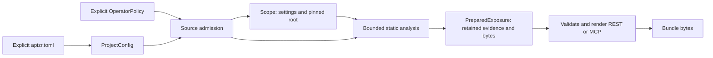

# Workspace contract

`apizr.workspace` owns explicit project settings, operator authority, captured
analysis sessions and compiler composition. This document defines their shared
boundary. The ownership inventory is `architecture/packages.toml`; its import
allowlist admits the existing core contracts and Pydantic. CLI adapters, optional
SDKs and plugin distributions consume this boundary rather than implementing it.
Importing the workspace namespace reads no files and grants no authority.

## Settings, authority and retained evidence

These values have different lifetimes and cannot substitute for each other:

| Value | Owner and admission | Guarantee |
| --- | --- | --- |
| `ProjectConfig` | `workspace.project.load_project(explicit_path)` | Closed `apizr.project/v1` declarations, resolved locations and bounded analysis settings |
| `OperatorPolicy` | `workspace.operator_policy` | Explicit grants for exact operations and targets; project declarations cannot create them |
| `Scope` | `workspace.analysis_session.load_scope(project_path, operator_policy)` | Captured policies and settings, plus a canonical absolute root and nonnegative device/inode identity |
| `PreparedExposure` | `workspace.compiler.prepare_exposure(...)` | Retained source/resource bytes with full Catalog, Graph, readiness, exposure policy and plan |
| Bundle mapping | `workspace.compiler.render_bundle(prepared, ...)` | Validated output bytes for one explicitly selected interface and backend |

The Python compiler accepts explicit settings directly; loading a project file or
creating a session is optional. `PinnedRoot` restricts analysis to the captured
directory identity and still requires an operator grant. A live `GitSnapshot`
uses its independently authorized acquisition and commit identity. No setting or
prepared context authorizes execution, signing, image build or publication.

## Project declarations

`load_project` reads only the named regular UTF-8 TOML file, bounded to 64 KiB.
It performs no directory search, policy-file read, plugin discovery, environment
interpolation or source import. Unknown fields, unknown versions, TOML date/time
values and coercion of strings/booleans/floats into integer bounds are rejected.
`ProjectConfig` and its existing nested models remain the executable definitions;
there is no second workspace configuration schema.

`root`, `readiness_policy` and `exposure_policy` resolve against the named file's
directory. Absolute local paths are accepted; URIs, empty paths and NUL are
refused. Source roots remain relative to the repository root. Standard directory
exclusions are added to the file's exclusions. CLI override precedence belongs to
the adapter and is specified in the [project guide](../getting-started/user-guide/project.md#paths-and-precedence).
Python callers pass the resolved settings explicitly to the compiler.

`application` declares exact dependency pins and selected resource files;
`plugins` declares artifact identities only. Loading either declaration installs
and executes nothing. Output locations, execution credentials and operator grants
are outside `apizr.project/v1`.

## Captured analysis sessions

`load_scope` first loads the explicit project declaration, revalidates supplied
operator authority and admits the root. It captures device/inode identity before
reading the selected readiness/exposure JSON files. Those files must be regular,
are limited to 64 KiB each and reject duplicate object keys. The resulting scope
contains policy values rather than paths to reopen.

The private worker handoff is limited to 1 MiB. `read_session` consumes and closes
its inherited regular-file descriptor, refuses duplicate JSON keys and strictly
revalidates the closed scope. `check_scope` rechecks both authorization and root
identity before work; workers recheck too. Replacing the root directory is refused.
Changing project/policy files after capture cannot widen an existing session.
Changes to source contents inside the same directory require fresh analysis;
an inode pin does not freeze those contents.

`mcp_session` wraps this scope with separately captured delivery inputs only when
requested by the operator. Its reader retains the existing plain-scope handoff
for installed read-only clients. `analysis_scope` gives compiler workers only
analysis grants; `history_scope` retains analysis/history grants. Neither passes
delivery credentials or signing authority to read-only workers. Editor requests
cannot replace captured roots or scan bounds; history operations independently
authorize the exact store.

`Scope` is a private handoff between launchers and workers, not a user-editable
project format or a new supported public wire schema.

## Compiler API and ownership

`assess_readiness` performs one bounded discovery and returns the independent
readiness report without applying exposure selection. `prepare_exposure` performs
one analysis, assesses readiness and computes the explicit exposure plan. It
retains the exact analyzed bytes and captures declared resources while source
authority is available. Resource capture is bounded and checks individual files;
it is not an atomic snapshot of a changing local filesystem.

`PreparedExposure` is an in-memory frozen dataclass over existing contracts.
Construction, including `dataclasses.replace`, copies `evidence.sources`,
`resources` and `dependency_archives` into read-only mappings of string paths to
immutable `bytes`. Mutating a caller's original dictionaries cannot change later
renderings. A mutable byte buffer is rejected with `TypeError`. The remaining
fields use their existing frozen contract models and canonical serializers.

Direct construction retains values; it does not certify their consistency or
grant authority. Each `render_bundle` revalidates the retained evidence/plan
linkage, source digests, selected dependencies, resource identities and source
provenance through the existing bundle admission. Fabricated or replaced values
cannot bypass that admission. This context is not a new serialized evidence
schema and must not be treated as a persistence format.

Rendering uses retained project bytes and installed generator resources. It never
reopens the source root or configuration files, so the same prepared context can
render REST and MCP after the project has been removed. A changed source revision
requires a new preparation. The result is a fresh caller-owned `dict[str, bytes]`;
writing files remains the separate `repository_interfaces.output.write_bundle`
operation. The compiler neither starts services nor probes execution backends.

## Refusals and compatibility

Operations return values or propagate exceptions without printing or exiting:

| Condition | Result |
| --- | --- |
| Missing or mismatched source grant; replaced pinned root | `AuthorizationDenied` with the existing fixed decision |
| Invalid declarations, bounds, JSON/TOML or canonical evidence | Existing validation/decoding `ValueError` subclasses; filesystem errors propagate |
| Readiness uncertainty | Report diagnostics and `exit_code`; selection remains a separate decision |
| Unknown or ineligible exposure selection | `ExposureRefused`, including diagnostics and the already computed readiness report when raised by preparation |
| Invalid rendering contract or forbidden backend | Existing `BundleRefused`, `PolicyRefused` or `ValueError`; no backend fallback |
| Non-byte prepared payload | `TypeError` at context construction |

An empty selection may produce an empty plan but cannot produce a service bundle.
Unselected uncertainty stays in the complete audit. The
[selected-evidence proof](exposure-plan-v1.md#complete-evidence-and-fail-closed-behavior) determines
which required diagnostics block a selected root. Existing project version,
session handoff shapes, canonical evidence bytes and CLI/Python bundle parity are
preserved. Qualifications cover those bytes, caller-mutation isolation, duplicate
authority refusal and replaced-root denial; package architecture gates enforce
the supported dependency direction.
