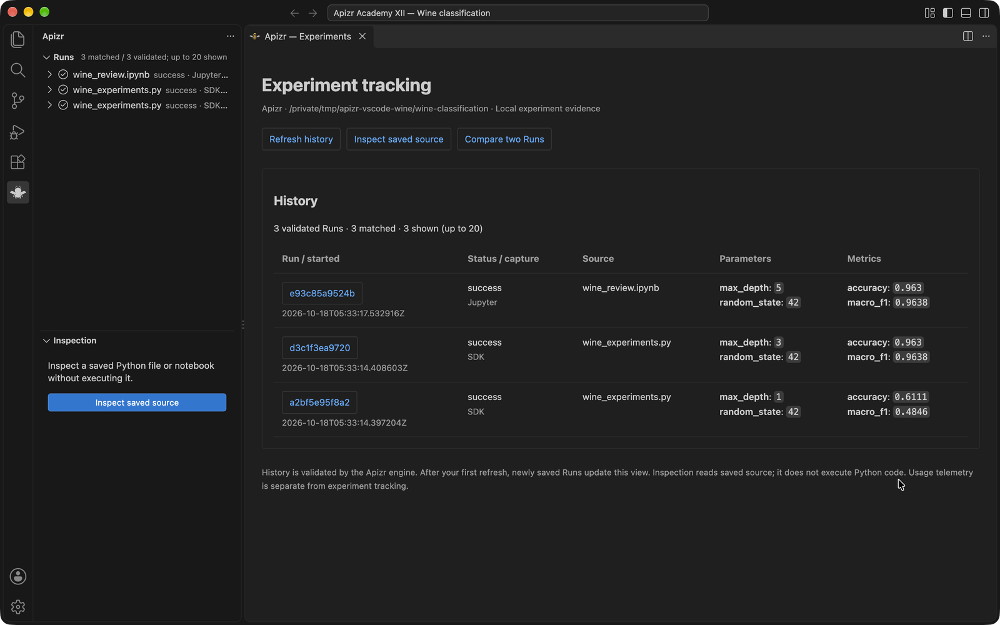
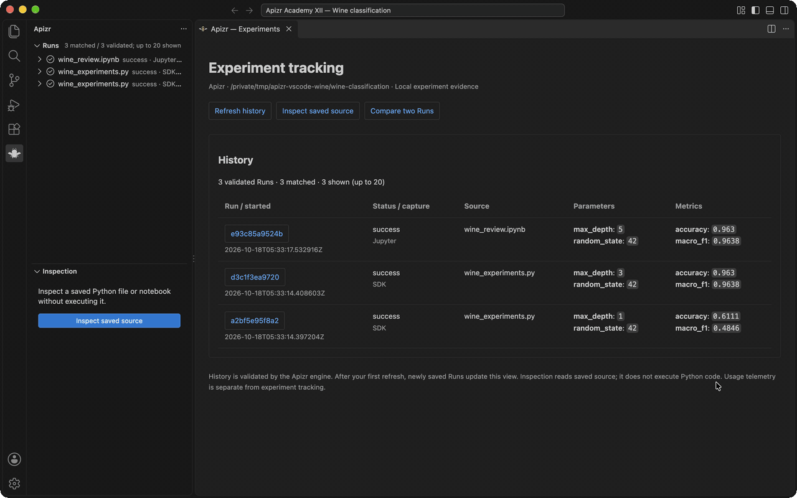
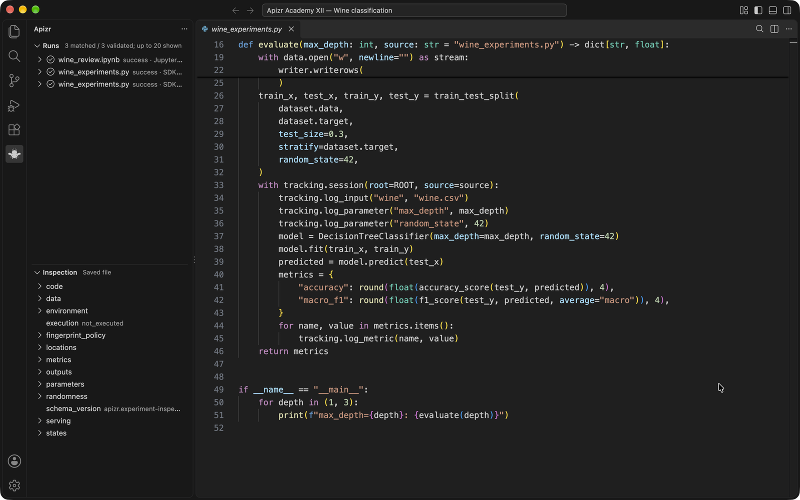

# Apizr for VS Code

Inspect Python and notebooks, browse local experiment history and compare Runs.

These are actual SDK and Jupyter executions on the public
[UCI Wine dataset](https://archive.ics.uci.edu/dataset/109/wine), shown in the
0.4.6 development extension. Parameters, accuracy and macro F1 come from the
retained Runs; the interface delegates history validation to the Apizr engine.

Short walkthrough using captured views of the running extension:

[Repeat the illustrated Academy lesson](https://apizr.outerspace.sh/academy/vscode/)
to train the models, inspect saved source and compare their results.

## Get started

1. Install the development VSIX in **VS Code 1.140+** and open a trusted project.
2. Accept **Install CLI**. Apizr installs its CLI and notebook support in a managed
   environment, then selects it automatically. Python 3.11–3.15 is required.
3. Configure your `apizr.toml` and operator policy in **Apizr: Open settings**.

Use the **Apizr bee** in the Activity Bar for the experiment dashboard, metrics,
parameters and Run details. Python editor shortcuts and the notebook toolbar
inspect saved code without executing it. **Apizr: Open CLI terminal** makes the
installed CLI available in a terminal. Existing CLI environments remain selectable.

**0.4.6 is under review.** The managed installer uses a pinned official source
commit; no Marketplace or PyPI publication is enabled here.

[Setup guide](https://apizr.outerspace.sh/reference/vscode/) ·
[Contributing](CONTRIBUTING.md) · [Engine](https://github.com/Alien6-Studio/outerspace-apizr)
